# 姑苏园林 Gusu Garden

A Suzhou classical garden (江南私家园林) built entirely in code with three.js, rendered offline into a 70-second 1080p60 film.

[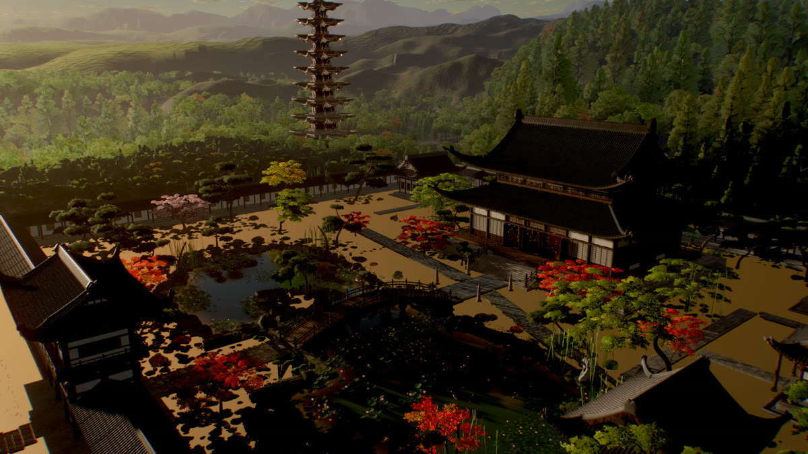](https://github.com/chainsaid/gusu-garden/releases/latest)

## Watch the film

**[gusu-garden-1080p60.mp4](https://github.com/chainsaid/gusu-garden/releases/latest)** is attached to the latest release: 70 seconds, 1920×1080, 60 fps, H.264, with music. The video is not stored in the repository.

## What this is

Everything you see is code. The repository contains no 3D models, no texture files, no HDRIs and no image assets. The buildings, roof tiles, bracket sets, railings, scholar's furniture, trees, banana palms, bamboo, lotus, carp, water, rockery, terrain, clouds and sky are all generated by JavaScript when the page loads, and every surface is procedural GLSL injected into three.js's physically based materials. The few textures the scene uses, such as foliage atlases and terrain masks, are computed or drawn onto canvases at load time. The only third-party runtime library is [three.js](https://threejs.org) (r186).

- About 31,000 lines of JavaScript build a scene of 24.4 million triangles.
- The world is deterministic. Every random choice comes from a seeded generator, so each load builds exactly the same scene.
- The film has 10 shots of 7 seconds each. Every shot opens on a macro close-up of one detailed object and pulls back to reveal the scene around it.
- The film is rendered one frame at a time in headless Chrome. Each frame averages 8 sub-frames, which gives anti-aliasing, motion blur, soft sun shadows and noise-free ambient occlusion.
- The music is the one element that is not code: "Finding Movement" by Kevin MacLeod, licensed under CC BY 4.0. It is not included in the repository; a script downloads it (see [Music](#music)).

## Gallery

All stills are single frames from the finished film.

<table>
  <tr>
    <td width="50%">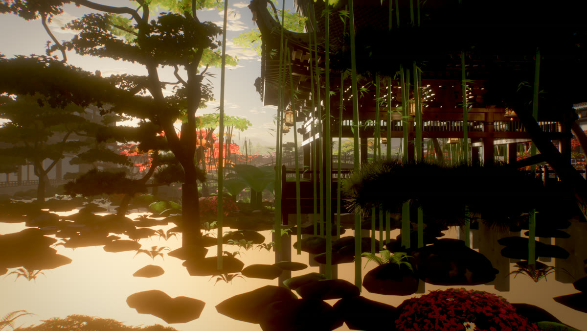<br><sub>Through a leak window at the pond (shot 1)</sub></td>
    <td width="50%">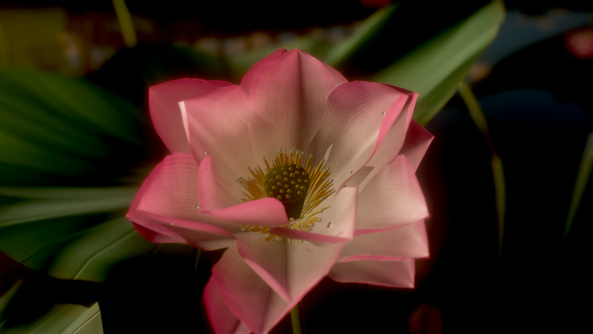<br><sub>Lotus in full bloom (shot 2)</sub></td>
  </tr>
  <tr>
    <td width="50%">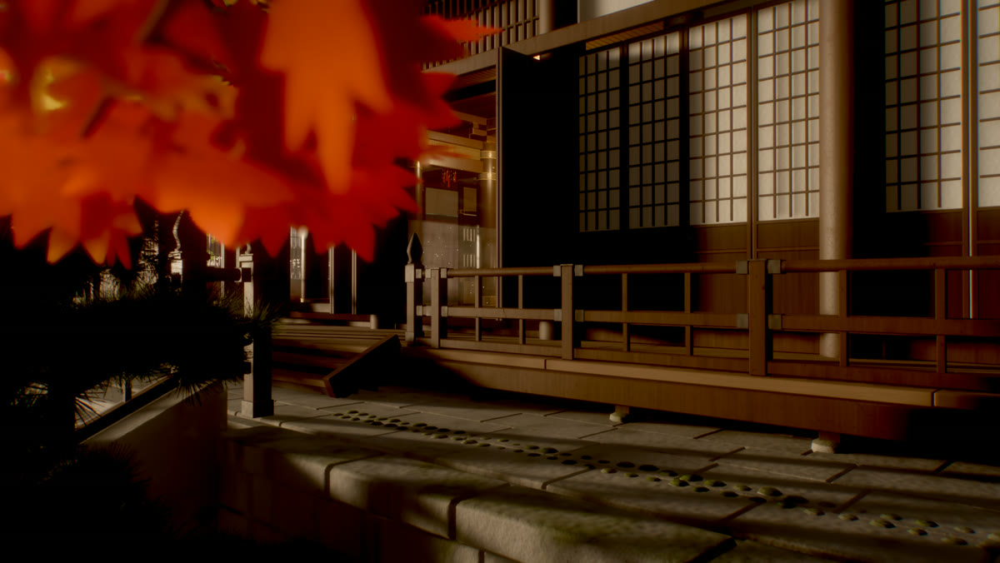<br><sub>Water drops on a banana palm leaf (shot 3)</sub></td>
    <td width="50%">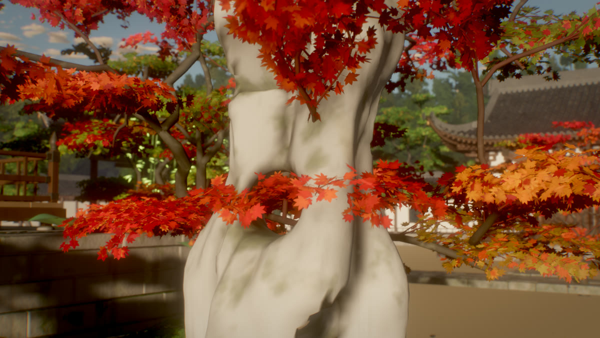<br><sub>Through Guanyun Peak (shot 4)</sub></td>
  </tr>
  <tr>
    <td width="50%">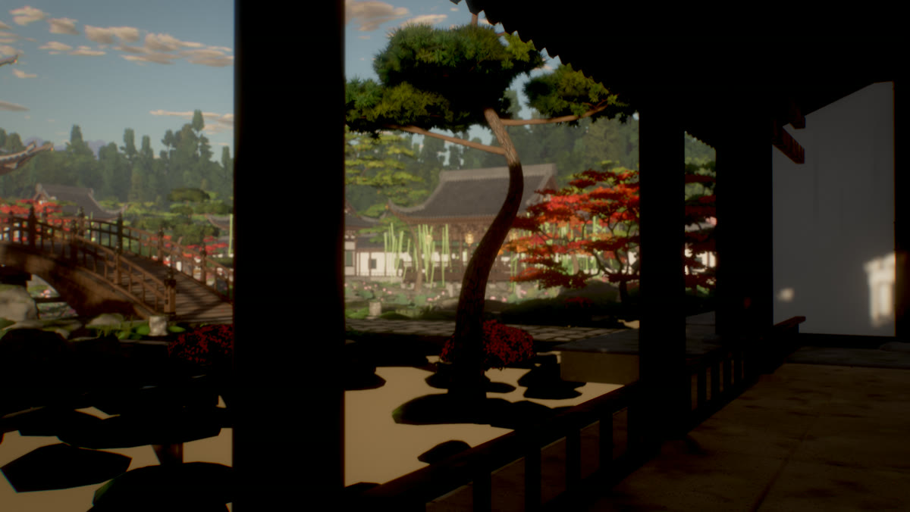<br><sub>The winding corridor (shot 5)</sub></td>
    <td width="50%">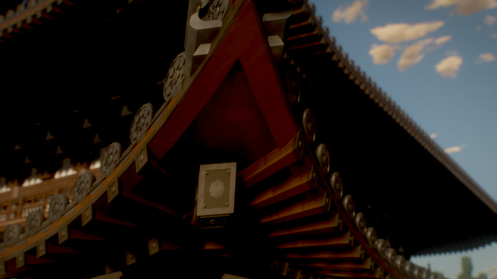<br><sub>The soaring eave corner (shot 6)</sub></td>
  </tr>
  <tr>
    <td width="50%">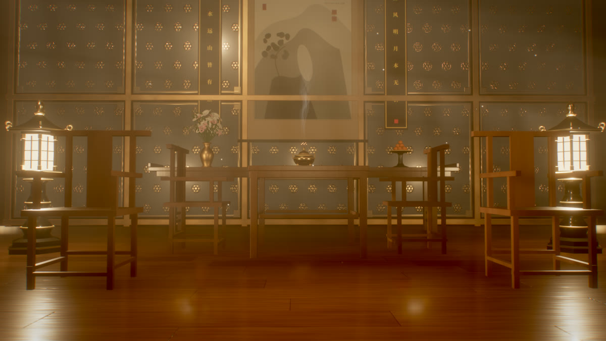<br><sub>The scholar's hall (shot 7)</sub></td>
    <td width="50%">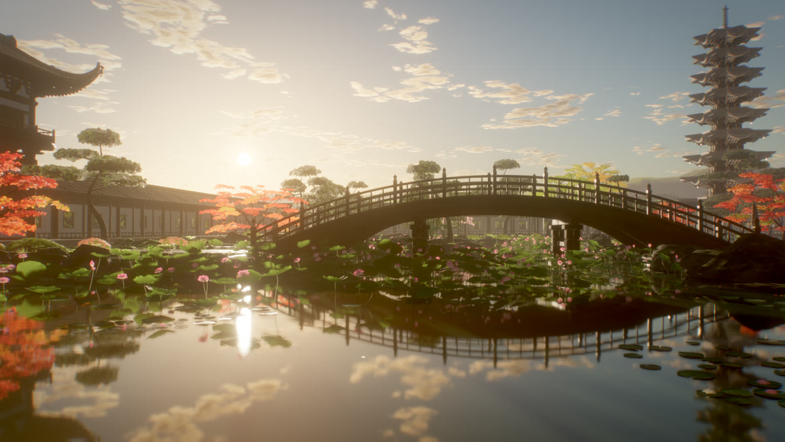<br><sub>Willow at the water pavilion (shot 8)</sub></td>
  </tr>
  <tr>
    <td width="50%">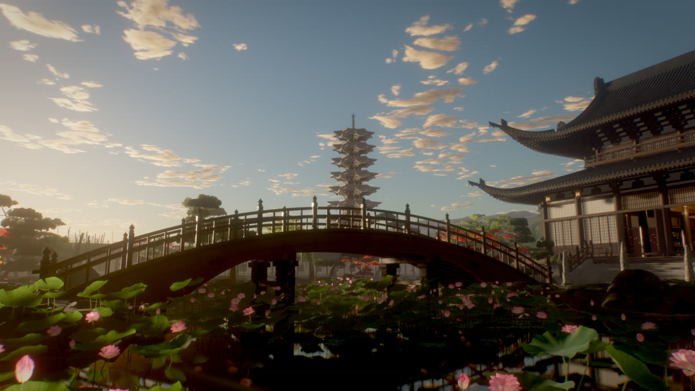<br><sub>Borrowed scenery in the mirror pond (shot 9)</sub></td>
    <td width="50%">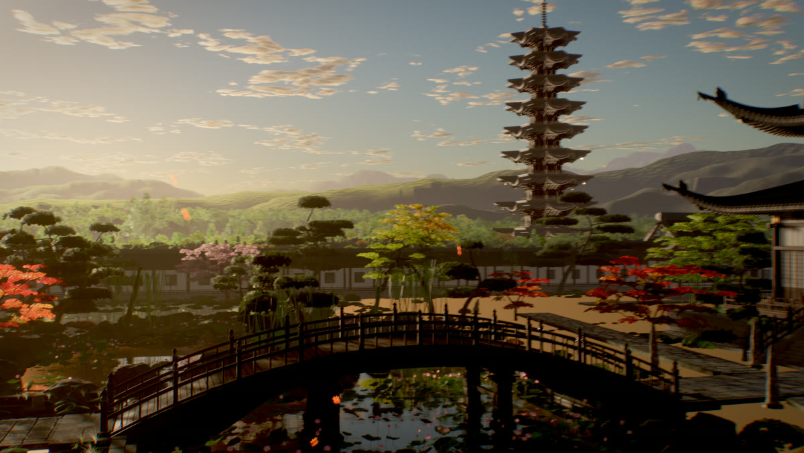<br><sub>The finale: a crane up over the garden (shot 10)</sub></td>
  </tr>
</table>

## Quick start

Requirements:

- [Node.js](https://nodejs.org) 22 or newer
- A browser with WebGL 2 for the interactive preview. The headless tools need Chrome or Edge; they find it automatically, or you can set the `CHROME` environment variable to the executable.
- [ffmpeg](https://ffmpeg.org) on `PATH` for contact sheets, the film and the music

```bash
git clone https://github.com/chainsaid/gusu-garden.git
cd gusu-garden
npm install
npm run dev
```

Open <http://localhost:5173/>. The first load builds the whole world and compiles its shaders, which can take a few minutes on an integrated GPU the first time (shaders are cached afterwards). The status line in the top-left corner shows progress.

The page is controlled by URL parameters:

| Parameter | Effect |
|---|---|
| *(none)* | Interactive preview at preview quality. Drag to orbit. Keys `1`–`9` and `0` play shots 1–10, `space` pauses, `f` returns to the free camera, and `c` copies the current camera as a `cam=…&look=…` query. |
| `shot=N&t=sec` | One still frame of the film: shot `N` (zero-based, `0`–`9`) at `t` seconds into the shot (`0`–`7`). Renders at final quality with 4 sub-frames. |
| `w=1920&h=1080` | Canvas size. The default is 1280×720. |
| `spp=8` | Sub-frames per frame (anti-aliasing, motion blur, soft shadows). |
| `q=preview` or `q=final` | Quality preset. `preview` uses a 2048² shadow map, 10 AO samples, no depth of field and sky-only ambient light. `final` uses an 8192² shadow map, 16 AO samples, depth of field and ambient light captured from the built scene. |
| `modules=terrain,pond` | Builds only the listed world modules: `terrain`, `pond`, `hall`, `interior`, `pagoda`, `bridge`, `buildings`, `props`, `vegetation`. Without `terrain`, a plain ground disc is used. |
| `cam=x,y,z&look=x,y,z&focal=35` | An explicit camera, in metres. The focal length is in millimetres for a 36 mm-wide sensor. |
| `exp`, `fstop`, `focus`, `dof=1`, `ao`, `bloom`, `fog`, `vol` | Post-processing overrides, for example `&exp=1.2&dof=1&fstop=2.8`. |

For example, <http://localhost:5173/?shot=0&t=5&w=1920&h=1080&spp=8> renders the frame at the top of this page.

## Rendering stills

`tools/snap.mjs` drives headless Chrome on your GPU. It loads the page once, builds the world once, then renders any number of views and saves each one as a PNG. Keep `npm run dev` running in another terminal.

```bash
# one still
node tools/snap.mjs "shot=0&t=5&w=1920&h=1080&spp=8" out/shot1.png

# several views from one page load
node tools/snap.mjs "w=1920&h=1080&spp=8" --view "shot=3&t=0.5" out/peak.png --view "shot=6&t=6.9" out/study.png

# contact sheet of all 10 shots at three moments each -> out/sheets/review.jpg
node tools/sheet.mjs --t 0.5,3.5,6.5 --tag review
```

`sheet.mjs` also takes `--shots 0,4,9`, `--w`, `--h`, `--spp` and `--extra "<query>"` for post overrides. A lock file in `out/` serialises GPU use, so tools started at the same time wait for each other.

Environment variables for the headless tools: `CHROME` sets the browser executable, `ANGLE` sets the ANGLE backend (`d3d11` by default on Windows, the browser's default elsewhere), and `VITE_PORT` sets the dev-server port if you run Vite on a port other than 5173.

## Rendering the film

```bash
npm run dev                     # terminal 1
node tools/render.mjs --w 1920 --h 1080 --fps 60 --spp 8 --out out/gusu-garden.mp4   # terminal 2
```

The page renders each frame, reads the pixels back and posts them to the Node process, which pipes raw RGBA into ffmpeg (libx264, CRF 14, preset `slow`, BT.709). Nothing is written to disk between the GPU and the encoder.

Measured on the machine that made the film, a laptop with an AMD Radeon 780M integrated GPU:

- building the world and compiling the shaders takes about 2 minutes with a warm shader cache. The first headless run on a fresh clone has no cache yet and can take about 8 minutes; later runs reuse the cache in `out/.chrome-profile`;
- a 1080p frame with 8 sub-frames takes about 3.3 seconds;
- the full film (4,200 frames) takes about 4 hours, including cool-down pauses.

The renderer idles 60 ms after every frame and rests for 15 s every 250 frames, so an integrated GPU does not run flat out for hours. These pauses add about 8 minutes to the full film. To change them, pass page parameters through `--extra`, for example `--extra "cool=0&restEvery=0"`.

Useful options:

- `--from N --to M` renders only frames N to M−1. `tools/splice.mjs` puts a re-rendered segment back into a finished film, frame-accurate.
- `--spp 2 --w 960 --h 540` makes a quick draft.
- `--crf` and `--preset` set the x264 quality.

## Music

The track is not redistributed in this repository. Download it, then edit it to the 70-second cut and mux it onto your render:

```bash
npm run fetch-music
node tools/score.mjs --video out/gusu-garden.mp4 --out out/gusu-garden_final.mp4
```

`fetch-music` downloads the MP3 from incompetech.com into `assets_audio/`, which git ignores, and checks it against the file the edit was timed with. `score.mjs` joins two sections of the track with a crossfade so that the string crescendo lands on the cut at 0:28 and the biggest hit lands on the cut to the scholar's hall at 0:42. It then normalises loudness to −16 LUFS and muxes the result as AAC. The video stream is copied, not re-encoded.

If you share a film made with this music, credit it as shown in [Credits](#credits).

## The film's 10 shots

| # | Time | Opens on | Reveals |
|---|---|---|---|
| 1 | 0:00 | A hexagonal leak window with bamboo shadows on the white wall | Pulls back through it to the whole lotus pond |
| 2 | 0:07 | A lotus in full bloom: stamens, seed pod and dew | Glides low through the lotus bed toward the stone bridge |
| 3 | 0:14 | A backlit banana palm leaf with a water drop running off it | Swings up to the scholar's window |
| 4 | 0:21 | A hole in the Guanyun Peak Taihu rock | Turns through it to the water pavilion on the far shore |
| 5 | 0:28 | The white corridor wall with a leak window and dappled bamboo | Slides along the winding corridor toward the hall |
| 6 | 0:35 | The soaring corner rafter with its upturned corner and cyan drip tiles | Tilts up into a high three-quarter view of the two-tier hall |
| 7 | 0:42 | The landscape scroll on the scholar's hall wall | Pulls back over the rosewood table, the guqin and the armchairs |
| 8 | 0:49 | A weeping willow over the Meirenakao bench at the water pavilion | Glides out over the rippling pond |
| 9 | 0:56 | A lotus pad beaded with water drops, just above the water, facing the sun | Rises and turns to the borrowed Beisi Pagoda and the bridge mirrored in the pond |
| 10 | 1:03 | Backlit maple leaves against the low sun | Cranes up and back over the whole garden and the hills behind it |

<p align="center">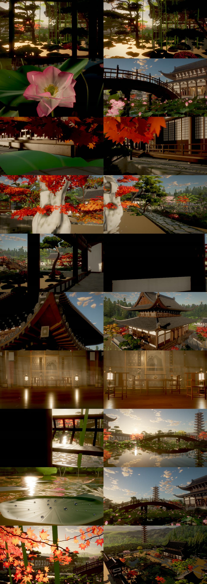</p>

## How it works

A short overview. [docs/ARCHITECTURE.md](docs/ARCHITECTURE.md) covers the frame pipeline, the shot system and how to add modules and shots.

- **Engine (`src/core/`)**
  - `sky.js`: a physically based sky with single-scattering Rayleigh, Mie and ozone, a cloud layer lit through the atmosphere, and an HDR sun disc.
  - `fog.js`: aerial perspective and height fog, written into every material's shader so that water reflections get the same haze. It also adds ambient-occlusion volumes, which are boxes that dim sky light inside the hall and under deep eaves.
  - `lighting.js`: one sun with an 8192² shadow map. The shadow frustum is fitted around each shot's subject, and the image-based light is captured from the sky and then from the built scene.
  - `post.js`: the sub-frame accumulation pipeline. Each sub-frame renders the HDR scene with 4× MSAA and SSAO and adds it into an accumulation buffer with a Gaussian weight. Across the sub-frames the camera, the sun and the shutter time are jittered, which produces anti-aliasing, soft shadows and motion blur. Each finished frame then gets depth of field, bloom, a blend of ACES and AgX tone mapping, a colour grade, vignette and grain. The pipeline also has a volumetric-light pass that ray-marches the sun's shadow map. The light shafts inside the hall are shadow-mapped slices from the interior module.
  - `materials.js`: `patch()`, which injects GLSL hooks (colour, roughness, normal, emissive, lighting, wind) into three.js's standard and physical materials, and the shared procedural library: chestnut tung-oil wood, dark iron fittings, cyan roof tile, white plaster, bluestone, granite with moss, and lotus stone. The Jiangnan palette is the default: `M.woodChestnut`, `M.tileCyan`, `M.plasterWhite`, `M.stoneCyan`, and `M.gold = M.iron` so no fitting reads as gilt.
  - `rng.js`: the seeded random number generator that every module uses instead of `Math.random`.
- **World (`src/world/`)**: nine modules, each a `build(ctx)` function: terrain, pond, hall, interior, pagoda, bridge, buildings, props and vegetation. `src/layout.js` is the shared site plan.
- **Shots (`src/shots.js`)**: camera keys with a lens per key (focal length, focus distance, f-stop). Orientation is interpolated as a direction, ease curves linger on the close-up, and an optional Gaussian smoothing removes snaps from hand-made keys. Each module can override the camera of its own hero shot in `src/shotkeys/<module>.js`.
- **Quality tools (`tools/`)**: `camcheck.mjs` reports camera speed, turn rate and acceleration spikes for every shot. `lumaflicker.mjs` measures frame-to-frame brightness flicker per screen region. `mcflicker.mjs` measures motion-compensated shimmer. `splice.mjs` replaces a re-rendered frame range in a finished film.

## Project structure

```text
gusu-garden/
├── index.html              page shell: canvas, status line, HUD
├── vite.config.js
├── src/
│   ├── main.js             URL parameters, world build, frame loop (preview / still / render)
│   ├── layout.js           site plan: where everything is, in metres
│   ├── shots.js            the 10 shots and the camera evaluator
│   ├── core/               engine: sky, fog, lighting, post pipeline, materials, geometry, noise, rng
│   ├── world/              world modules (terrain, pond, hall, interior, pagoda, bridge,
│   │                       buildings, props, vegetation) and their helper files
│   └── shotkeys/           per-module camera overrides for the hero shots
├── tools/
│   ├── snap.mjs            headless GPU stills
│   ├── sheet.mjs           contact sheets
│   ├── render.mjs          offline film render (headless Chrome -> ffmpeg)
│   ├── fetch-music.mjs     downloads the music (not redistributed)
│   ├── score.mjs           edits the music to the cut and muxes it
│   ├── splice.mjs          replaces a frame range in a finished film
│   ├── camcheck.mjs        camera motion check (CPU only)
│   ├── lumaflicker.mjs     brightness flicker metric
│   ├── mcflicker.mjs       motion-compensated shimmer metric
│   ├── flickercheck.mjs    second-difference flicker metric
│   └── lib/chrome.mjs      browser detection and GPU flags
├── docs/
│   ├── ARCHITECTURE.md
│   └── images/             stills from the film
├── CREDITS.txt
└── LICENSE
```

npm scripts: `dev`, `build`, `snap`, `sheet`, `render`, `fetch-music`, `score`, `camcheck` and `flicker` (`lumaflicker.mjs`). Pass tool options after `--`, for example `npm run render -- --spp 2 --w 960 --h 540`.

## The Jiangnan design

The garden is a private water court (水院) in the Suzhou idiom. What that means in practice:

- **Palette.** White plaster walls (白粉墙), cyan roof tile (小青瓦), chestnut tung-oil wood (栗壳色桐油木), bluestone (青石) and dark forged-iron fittings. No vermilion lacquer and no gilt anywhere.
- **The main hall** is a two-tier 歇山 roof with 嫩戗发戗 upturned corners, plain columns, bracket sets with a diagonal 昂, lattice long-windows and a 山花 filled with 荷叶墩 blocks and 悬鱼 pendants.
- **Ridge ends** carry 螭吻 — a dragon head with an open mouth, bulging eyes, two horns and the 剑把 sword hilt — never a Japanese ogre-face tile. Eave tile ends are 莲花瓦当: a rimmed disc with eight lotus petals and a seed pod.
- **The tower** is borrowed scenery (借景): a nine-storey, eight-sided 北寺塔 standing outside the wall ~118 m WNW of the hall, seen over the trees and mirrored in the pond.
- **Stone.** Taihu peaks (太湖石) in the courtyard and at the leak windows, stacked-rockery banks around the pond, stone spurs, drum stools and stepping stones. No stone lanterns.
- **Plants.** Bamboo, banana palms (雨打芭蕉), weeping willows, natural-form pines, maples, wisteria. No cherries, no clipped mounds, no raked gravel.
- **Inside**, the hall is a scholar's studio: a landscape scroll, black-lacquer couplets, a rosewood table, a guqin, armchairs, a luohan bed and a curio shelf. Long-windows with 步步锦 lattices over 明瓦, and a ceiling of 卷棚轩 canopies over an open 彻上明造 middle.

`docs/REFACTORING_PLAN.md` records the full audit of what was changed from the Japanese temple this started from, item by item.

## How it was made

Gusu Garden was built with [Claude Code](https://claude.com/claude-code), with Claude Opus 5.5 orchestrating a set of parallel agents. Each agent owned one world module and, for most modules, the camera of its hero shot. All of them shared the site plan in `src/layout.js` and the engine in `src/core/`. The agents rendered stills of their work on the GPU through headless Chrome, compared them with reference images and iterated on what they saw. Camera motion and temporal stability were measured with the tools in `tools/` before the final render. The reference images are not part of this repository.

## Credits

Music:

> "Finding Movement" Kevin MacLeod (incompetech.com)<br>
> Licensed under Creative Commons: By Attribution 4.0<br>
> https://creativecommons.org/licenses/by/4.0/

The music is edited for length by `tools/score.mjs` and is not redistributed in this repository.

[three.js](https://github.com/mrdoob/three.js) is MIT licensed, © 2010–2026 three.js authors.

See [CREDITS.txt](CREDITS.txt).

## License

The code is released under the MIT License. See [LICENSE](LICENSE). The music is not covered by this license; it is licensed separately under CC BY 4.0, as listed in [Credits](#credits).
