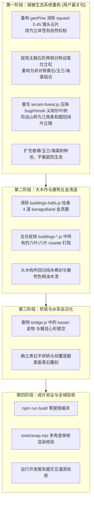

# 姑苏园林非江南元素全域审计与改造方案指南
# Comprehensive Audit of Non-Jiangnan Remnants & Authentic Suzhou Garden Transformation Blueprint

---

## 1. 概述与指导原则

本工程致力于构建一套纯 Three.js 程序化生成的**姑苏古典文人私家园林（Suzhou Classical Literati Garden）**。全场景坚持**零外部 3D 模型、零图片光栅贴图、零外部 HDRI**，全部几何、程序纹理与着色均由算法实时生成。

在前期演进过程中，场景虽已确立了“粉墙黛瓦”的材质色调与太湖石假山，但代码底层仍深烙着原作者早期套用的**日式禅宗佛寺（Zen Buddhist Temple）与和风神社庭园**基因。用户明确指出：**“树就很日式，还有哪些元素不是江南风格？”**

本文件基于对全仓代码（大木作、小木作、五金构件、桥梁、庭院植被、背景山林、室内陈设）的深度地毯式排查，系统性梳理出所有违背江南文人造园法度的和风残余，并制定精确至代码函数与变量的落地改造实施方案。

> **2026-10-29 复核说明**
>
> 第 3 节所列各专项已全部整改落地，第 5 节验收清单亦逐项复核勾选。本次复核另补充了原清单遗漏的**灌木刈込球（karikomi）**专项（见 3.5 节）——庭树木本已完成去云片化，但地表灌木层仍是杜鹃球/黄杨球修剪半球，且主殿台阶与塔台四角呈轴对称，本轮一并置换为南天竹、栀子、八角金盘、迎春的自然丛生形态。文中行号均为复核时的当前值。

---

## 2. 核心冲突对比矩阵：和风禅宗庭园 vs. 姑苏文人园林

| 维度 | 现存和风禅宗/神社特征（代码实存） | 真实姑苏文人园林法度（《园冶》《长物志》） |
| :--- | :--- | :--- |
| **松树形制** | **日式庭木（Niwaki）仕立松**：多层水平压扁的馒头型云片垫（`squash = 0.45`），人工修剪痕迹极重 | **文人画苍松/罗汉松**：取法文征明、沈周、倪瓒画意，主干盘曲苍劲，枝柯天然舒展，冠顶呈圆穹，**绝不作人工水平云片剪裁** |
| **庭院配植** | 主殿石阶前**对称布置两株剪枝迎客松**；树种单一化（黑松 + 鸡爪槭 + 樱花） | **虽由人作，宛自天开**；绝不搞轴线对称树木；讲究“玉堂富贵”（白玉兰/海棠）、“雨打芭蕉”（蕉石修竹）、金桂银桂、古樟遮荫 |
| **背景远山** | **日本柳杉（Sugi）与日本扁柏（Hinoki）纯林**：60%~70% 高耸尖刺针叶树，呈现京都岚山/日光杉林剪影 | **吴中丘陵烟雨林相**：虎丘、天平山、穹窿山意境；以常绿阔叶（香樟、槲栎、朴树）与江南翠竹为主，起伏柔和，青翠温润 |
| **建筑大木作** | 柱身、梁头、抱厦包裹大量**金铜金具套筒（Kanagu Band）**；梁柱散布**六叶/八叶鎏金钉隐（Rosette）** | **纯正木构榫卯**：栗壳桐油木或生漆本色，大木绝无铜皮铁箍；暗销暗钉平磨收口，杜绝金属花瓣装饰 |
| **桥梁形制** | **太鼓桥五金**：桥身饰有**饰金具（Kazari-kanagu）**与**玉缘（Tama-buchi）**包边；心形（猪目 Inome）镂空 | **青石平拱桥 / 廊桥**：太湖青石或花岗岩素面砌筑，仰覆莲瓣望柱头，古朴无华，无任何金属饰件包边 |
| **室内门窗** | 糊白纸的**障子门（Shoji）**与日式七宝纹（Shippo-tsunagi） | **苏式落地长窗（隔扇门）与半窗**：通透步步锦、冰裂纹、龟背锦棂格；御窑金砖地面与文人匾额挂落 |

---

## 3. 详细排查清单与改造方案

### 3.1 模块一：植被与生态系统（✅ 已全部整改，2026-10-29 复核）

#### 3.1.1 松树形态去“云片化”（✅ `src/world/vegetation-tree.js`）
- **整改结果**：`genPine()`（约 :849 起）已废除 `squash = 0.45` 扁平云片垫，改为 `addCrown(..., fullness = rng.range(0.84, 1.0))` 的三维立体椭球针叶簇 + 子球簇 + 穿冠小枝，主干仍保文人折枝笔意；`vegetation-core.js` 头注释已改为「自然三维针叶簇，不引入剪切水平垫」。
- **验收**：`npm run snap` 各机位松树剪影自然蓬松，无馒头云片感。

#### 3.1.2 庭院树木点位去“对称迎客化”（✅ `src/world/vegetation.js`）
- **整改结果**：`x:1.6 / 18.4, z:-7.0` 两株对称仕立松已删除；主殿前庭改为单株偏轴垂丝海棠类（`crabapple, x:19.2, z:-6.4` 依粉墙斜出），配香樟、自然形老松与白玉兰错落（约 :1363-1372）。
- **验收**：殿前月台轴线通透，无轴线对称树木。

#### 3.1.3 树种多样性与色彩生态（✅ `src/world/vegetation.js`）
- **整改结果**：`fillTypes`（约 :1390）已为 `['camphor','camphor','maple','pine','camphor','mapleRed','crabapple','magnolia','maple','camphor']`——香樟占四成；`cherry` 已彻底退出树种池（纹理层早已重构为碧桃/红梅，内部 species 名亦已统一改名 `peach`）。
- **验收**：庭院四时有香樟浓荫、玉兰春华、红枫秋色。

#### 3.1.4 背景山体与远景林相去京都化（✅ `src/world/terrain-forest.js`）
- **整改结果**：`coniferP`（约 :313）由 `0.42 + 0.45*…` 压至 `clamp(…, 0.01, 0.14)`，优势种全面切换为阔叶圆冠（槲树/冬青/香樟/枫），新增 `bambooP`（8%~28%）竹丛集于湿润沟谷；模板层 `sugiTpl/hinokiTpl` 已重构为 `broadleafTpl/coniferTpl/bambooTpl`（:76/:131/:160，针叶仅作本土松柏点缀）。
- **验收**：航拍远山天际线圆润青翠，无刺天杉林剪影。

---

### 3.2 模块二：建筑大木作与金属五金（✅ 已全部整改）

#### 3.2.1 柱身与梁坊“金具套筒”（✅）
- **整改结果**：`kanaguBand` 与 `colBand(..., K.gold)` 全仓调用点归零（`buildings-kanagu.js` 整文件已随 335605a 提交删除），柱身回归栗壳桐油木本色直落青石柱础；残余真金色材质亦已清除（见重构计划 **P0-18**）。

#### 3.2.2 梁柱“六叶/八叶鎏金钉隐”（✅）
- **整改结果**：全仓 `rosette(` 调用点归零；仅存的梁端套筒死函数 `sleeve()` / `goldPlate()`（`hall-orn.js`，kazari-金物 残留）已于 2026-10-29 删除。受力表达改用中式平齐木销或隐入桐油木色漆面之下。

---

### 3.3 模块三：桥梁与水系构件（✅ `src/world/bridge.js`）

- **整改结果**：kazari 金物、卷草铜片、猪目心形镂空与鎏金花盘几何全部删除，仅存的历史镜头注释亦已改写；拟宝珠铜套柱头改青石素雕莲瓣（**P0-10**），桥形制由陡拱太鼓桥收敛为矢高 1.55 m 的江南青石平拱桥（**P0-15**），桥身通体水磨青石砌筑、栏板望柱素雅莲瓣。

---

### 3.4 模块四：室内陈设与门窗（✅ `src/world/interior-*.js`）

- **整改结果**：室内障子门（自发光纸）已改江南隔扇——透光部分用明瓦/绢背（`M.mingwa`：半透明、不自发光），棂格改步步锦；格天井满铺方格改前后卷棚轩 + 彻上明造（**P0-11 / P0-12**）。2026-10-29 已删除 `M.shoji` 别名与 `M.mingwa || M.shoji` 死兜底；榻榻米、佛堂死代码（含 `M.tatami`）已随 **P2-8** 清空。翘头条案、太湖石清供、书案画轴等文人陈设均已在渲染。
- **地坪已落实（2026-10-29）**：本节原要求「地坪严格落实为苏州御窑金砖」，现已落地——原 `M.woodFloor`（0.30 m 窄板 + 木纹年轮 + clearcoat 0.9 镜面蜡 + 深栗褐，近日式数奇屋「板の間」）重写为 **`M.floorBrick`**：0.58 m 见方对缝、冷青灰、缝 0.0018 m、金星颗粒 + 踩踏包浆 + 四边磨圆，roughness 0.38 / clearcoat 0.40 / envK 0.45。建筑木楼板 `M.woodFloorX/Z` 按苏式做法保留。见重构计划 **P0-GROUND-2**。

---

### 3.5 模块五：灌木刈込球（原审计遗漏项，✅ 2026-10-29 整改）

- **原代码现况**（已修复）：`vegetation.js` 的 `addMound()` 以“主半球 + 2~4 子半球堆叠 + 球面均匀撒叶卡”生成日式修剪灌木球（杜鹃球/黄杨球），注释自承 `a clipped mound is a cluster of overlapping domes (karikomi)`；主殿台阶两侧 `[-6.5,2.2]` 与 `[17.8,26.5]` 双带关于 x=10 严格轴对称，塔台四角各对称 3 丛；Web 端（`web/src/scene/vegetation.js`）同形制——`SphereGeometry` 半球 + 等距镜像撒点。
- **整改方案（已落地）**：
  1. **图集换中式品种**：`makeShrubAtlas()` 扩为 1536×1024 六格图集——cell 0 通用阔叶（樟树冠层共用），cell 1 南天竹、cell 2 栀子、cell 3 八角金盘、cell 4 迎春、cell 5 南天竹秋色（羽状复叶、革质叶、掌状裂叶、黄花、红果均为 Canvas 2D 程序化绘制，仍守零外部贴图底线）。
  2. **丛生形态**：每丛 3~6 根斜向枝条（`shoots/spread/lean/hRatio/ragged` 参数化），每枝一枚偏心小不透明核心，叶卡沿枝条分布——基部稀疏、枝端加密、边缘参差，彻底消除几何球感。
  3. **撒点去对称**：台阶前轴线让空（西侧一组松散丛、东侧零星数丛，正对台阶的中段清空），塔台改台缘圆周不规则散布 11 丛；Web 端同步去镜像化并改丛生单体（`mergeGeometries` 合成，仍走 `InstancedMesh`，实例数不变）。
- **验收**：`npm run snap` 主厅前视角与航拍确认——台阶轴线通透直达主厅，灌木呈参差丛生剪影，无修剪球与轴对称痕迹；`build` / `build:web` 零报错。

---

## 4. 实施阶段与分步计划

---

## 5. 验收标准（Checklist，2026-10-29 复核勾选）

- [x] **植被系统**：
  - [x] 松树树冠不再有平整水平切削的人工馒头云片感；
  - [x] 主殿入口两侧彻底消除对称迎客松；
  - [x] 背景山体天际线圆润青翠，不再有一排排刺天的日本杉木剪影；
  - [x] 庭院内出现圆浑如盖的江南香樟与清丽海棠/玉兰；
  - [x] 灌木层无刈込修剪球，南天竹/栀子/八角金盘/迎春自然丛生，撒点无轴对称。
- [x] **建筑构件**：
  - [x] 主殿与廊道立柱无任何镀金金属箍带；
  - [x] 梁枋交界处无日式六叶/八叶鎏金铜花钉隐；
  - [x] 桥梁无任何饰金具与猪目心形镂空。
- [x] **地面铺装与室内地坪**（2026-10-29 勘查新增，2026-10-29 **已施工** → 详见重构计划**阶段十**）：
  - [x] 甬道两侧无枯山水耙纹白砂——`tg_yongdao()` 已重写为「仄砖镶边 1.70~2.06 m + 青灰碎石散铺 2.06~2.85 m」，耙沟与白砂色 `vec3(0.56,0.54,0.50)` 已删除；
  - [x] 室内地坪为**苏州御窑金砖**——`interior-mats.js` 的 `M.floorBrick`：0.58 m 见方对缝、冷青灰 `vec3(0.30,0.325,0.335)`、缝 0.0018 m、金星云母颗粒 + 踩踏包浆 + 四边磨圆，roughness 0.38 / clearcoat 0.40；
  - [x] 甬道石板无 uchimizu 打水——`wetBase` 降至 0.17/0.14，`film` 近镜面水膜整段删除，只留雨后潮气；
  - [x] 甬道石材为冷青灰，无粉红长石/铁锈染色——`pink feldspar granite` 与 `iron-stained` 分支已删除，调色板整体压到冷青灰；
  - [x] 庭院出现花街铺地——新增 `tg_huajie()`：Worley 卵石场 + 万字锦/鱼鳞/冰裂纹/海棠砖瓦纹样，沿每条甬道边缘由内向外排布。
- [x] **命名与注释**（2026-10-29 新增）：
  - [x] 内部 species 名 `'cherry'` 已统一改名 `'peach'`（纹理层早已是碧桃/红梅）；
  - [x] 全仓源码（`src/` + `web/src/`）grep 日式罗马字术语（kazari/kanagu/karikomi/sugi/sasa/pieris/shoji/kasuga/giboshi…）归零；
  - [x] `sleeve()` / `goldPlate()` 死函数与 `M.shoji` 别名已删除；
  - [x] 地面层术语已清理（参道→甬道、枯山水→石景岛、`ishigumi`→叠石、去 `mizo`/`uchimizu`、全链路 `g_wG`→`g_wP`，见**阶段十 P0-GROUND-6**）。
- [x] **工程底线**：
  - [x] 严格遵守零外部 `.gltf`/`.obj`、零外部图片贴图底线；
  - [x] `npm run build` 与 `npm run build:web` 0 警告 0 报错通过。

