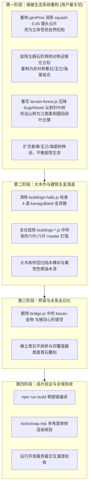

# 姑苏园林非江南元素全域审计与改造方案指南
# Comprehensive Audit of Non-Jiangnan Remnants & Authentic Suzhou Garden Transformation Blueprint

---

## 1. 概述与指导原则

本工程致力于构建一套纯 Three.js 程序化生成的**姑苏古典文人私家园林（Suzhou Classical Literati Garden）**。全场景坚持**零外部 3D 模型、零图片光栅贴图、零外部 HDRI**，全部几何、程序纹理与着色均由算法实时生成。

在前期演进过程中，场景虽已确立了“粉墙黛瓦”的材质色调与太湖石假山，但代码底层仍深烙着原作者早期套用的**日式禅宗佛寺（Zen Buddhist Temple）与和风神社庭园**基因。用户明确指出：**“树就很日式，还有哪些元素不是江南风格？”**

本文件基于对全仓代码（大木作、小木作、五金构件、桥梁、庭院植被、背景山林、室内陈设）的深度地毯式排查，系统性梳理出所有违背江南文人造园法度的和风残余，并制定精确至代码函数与变量的落地改造实施方案。

---

## 2. 核心冲突对比矩阵：和风禅宗庭园 vs. 姑苏文人园林

| 维度 | 现存和风禅宗/神社特征（代码实存） | 真实姑苏文人园林法度（《园冶》《长物志》） |
| :--- | :--- | :--- |
| **松树形制** | **日式庭木（Niwaki）仕立松**：多层水平压扁的馒头型云片垫（`squash = 0.45`），人工修剪痕迹极重 | **文人画苍松/罗汉松**：取法文征明、沈周、倪瓒画意，主干盘曲苍劲，枝柯天然舒展，冠顶呈圆穹，**绝不作人工水平云片剪裁** |
| **庭院配植** | 主殿石阶前**对称布置两株剪枝迎客松**；树种单一化（黑松 + 鸡爪槭 + 樱花） | **虽由人作，宛自天开**；绝不搞轴线对称树木；讲究“玉堂富贵”（白玉兰/海棠）、“雨打芭蕉”（蕉石修竹）、金桂银桂、古樟遮荫 |
| **背景远山** | **日本柳杉（Sugi）与日本扁柏（Hinoki）纯林**：60%~70% 高耸尖刺针叶树，呈现京都岚山/日光杉林剪影 | **吴中丘陵烟雨林相**：虎丘、天平山、穹窿山意境；以常绿阔叶（香樟、槲栎、朴树）与江南翠竹为主，起伏柔和，青翠温润 |
| **建筑大木作** | 柱身、梁头、抱厦包裹大量**金铜金具套筒（Kanagu Band）**；梁柱散布**六叶/八叶鎏金钉隐（Rosette）** | **纯正木构榫卯**：栗壳桐油木或生漆本色，大木绝无铜皮铁箍；暗销暗钉平磨收口，杜绝金属花瓣装饰 |
| **桥梁形制** | **太鼓桥五金**：桥身饰有**饰金具（Kazari-kanagu）**与**玉缘（Tama-buchi）**包边；心形（猪目 Inome）镂空 | **青石平拱桥 / 廊桥**：太湖青石或花岗岩素面砌筑，仰覆莲瓣望柱头，古朴无华，无任何金属饰件包边 |
| **室内门窗** | 糊白纸的**障子门（Shoji）**与日式七宝纹（Shippo-tsunagi） | **苏式落地长窗（隔扇门）与半窗**：通透步步锦、冰裂纹、龟背锦棂格；御窑金砖地面与文人匾额挂落 |

---

## 3. 详细排查清单与改造方案

### 3.1 模块一：植被与生态系统（代码破绽最深，用户重点指出）

#### 3.1.1 松树形态去“云片化”（`src/world/vegetation-tree.js`）
- **代码现况**：
  - `vegetation-tree.js:835-847` 的 `genPine()` 中，定义了 `addPad(c, rp, yaw, attach, pd, squash = 0.45)`。虽然注释标注了“Jiangnan ancient pine”，但核心生成逻辑依旧是创建**压扁的椭球云片垫子**（`pads.push({ c, rx: rp, ry: rp * squash ... })`），导致生成的松树依然是日式庭木（Niwaki）的扁平云片剪纸感。
  - `vegetation-core.js:2` 明确写着：`// VEGETATION — opaque foliage cores. A clipped 庭木 pine pad is a dense, ...`。
- **改造方案**：
  1. 重构 `genPine` 的枝叶簇分布算法：取消扁平云片（`squash = 0.45`），将松叶聚簇改为**三维自然球冠/半球形松针簇**（`squash = 0.85~1.0`），让松针在空间中立体蓬松。
  2. 增强主干与大枝的文人折枝笔意（文征明笔法）：主干苍劲曲折，出枝有“挺拔、偃仰、顾盼”之态，下层枯枝折落，上层苍翠蓬勃。
  3. 彻底重写 `vegetation-core.js` 的核心遮罩，使其不再生成水平扁平的“馒头垫”。

#### 3.1.2 庭院树木点位去“对称迎客化”（`src/world/vegetation.js`）
- **代码现况**：
  - `vegetation.js:1341-1343` 明确写入了日式神社/寺社入口的陈设方式：
    ```javascript
    // small 庭木 pines flanking the hall stair
    specs.push({ id: id++, type: 'pine', x: 1.6, z: -7.0, h: 3.4, lean: 0.35, leanAz: Math.PI * 0.15, padScale: 0.8, hStart: 0.22, nBranches: 5, hero: true });
    specs.push({ id: id++, type: 'pine', x: 18.4, z: -7.0, h: 3.2, lean: 0.35, leanAz: Math.PI * 0.85, padScale: 0.8, hStart: 0.22, nBranches: 5, hero: true });
    ```
    在主殿台阶两侧（x=1.6 与 x=18.4，z=-7.0）对称各摆放了一棵斜倾 35 度的矮化仕立松。
  - 庭院周边仍有多处日式孤植矮化庭木（`vegetation.js:1344-1347`）。
- **改造方案**：
  1. **彻底移除主殿台阶前的对称迎客松**。
  2. 依《园冶·相地/装折》重构主入口与庭院配植：
     - 一侧配置**太湖石峰伴生芭蕉与翠竹**（“蕉叶半展，翠竹摇曳”）；
     - 另一侧配置姿态秀逸的**白玉兰或垂丝海棠**（高低错落，疏影横斜）；
     - 殿前月台旁留出开朗空间，避免矮松堵塞视觉轴线与粉墙漏窗。

#### 3.1.3 树种多样性与色彩生态（`src/world/vegetation.js` & `vegetation-tree.js`）
- **代码现况**：
  - `vegetation.js:1369` 的树种池完全被日式常客垄断：
    ```javascript
    const fillTypes = ['maple', 'maple', 'pine', 'pine', 'pine', 'mapleRed', 'cherry', 'cherry', 'maple', 'pine'];
    ```
  - 缺乏江南园林的当家阔叶大树（香樟）以及苏州代表性树木（桂花、海棠、银杏）。
- **改造方案**：
  1. **新增香樟（Camphor）生成器**：江南园林最核心的绿荫巨树，拥有圆浑庞大的主冠伞盖、繁茂绿叶与厚重分枝。
  2. **新增海棠/玉兰树型**：春华灼灼，与白粉墙构成经典“粉黛衬春红”的江南取景画幅。
  3. **丰富常绿与落叶比例**：引入金桂（细密碎花与深绿圆灌木丛）、乌桕/银杏（秋日金黄），稀释日式红枫与吉野樱的独占感。

#### 3.1.4 背景山体与远景林相去京都化（`src/world/terrain-forest.js`）
- **代码现况**：
  - `terrain-forest.js:2` 明确写着：`// Backdrop forest: thousands of instanced card trees (cryptomeria / hinoki`。
  - `terrain-forest.js:130` 的 `sugiTpl()` 精准绘制了日式柳杉与扁柏的直立层叠针叶锥体。
  - `terrain-forest.js:282` 计算针叶林概率：`coniferP = clamp(0.42 + 0.45 * ...)`，针叶树在远山占比超过 60%，且树高设定高达 19~31 米（`terrain-forest.js:284`），导致整个远山天际线宛如日本京都岚山或箱根杉林。
- **改造方案**：
  1. 将针叶树（柳杉/扁柏）的出现概率 `coniferP` 从 0.65 压降至 0.15 以下，且仅作为深山零星点缀的松柏。
  2. 将远山优势树种全面切换为**江南阔叶林（香樟、槲树、冬青）与竹林丛**，大幅增加圆冠、伞冠（`broadleaf`）的覆盖度。
  3. 调整山冠高度曲线，使远景丘陵呈现平缓柔和的吴中水乡丘陵（“山含黛色，水弄碧漪”）。

---

### 3.2 模块二：建筑大木作与金属五金（和风权现造残留）

#### 3.2.1 柱身与梁坊“金具套筒（Kanagu Band）”（`src/world/buildings-halls.js` & `buildings-kanagu.js`）
- **代码现况**：
  - `buildings-halls.js:304-307`：
    ```javascript
    lb.add(kanaguBand(R, 'base', kHero), K.kanagu || K.gold, m4([x, yP + 0.1, z], [0, Math.PI, 0]));
    lb.add(kanaguBand(R, 'eye', kHero), K.kanagu || K.gold, m4([x, 1.86, z], [0, Math.PI, 0]));
    lb.add(colBand(R, 0.12, 36, 0), K.gold, m4([x, 4.08, z]));
    lb.add(colBand(R, 0.1, 36, 0), K.gold, m4([x, yLT - 0.42, z]));
    ```
    大殿立柱上竟套有 4 道五金箍带（包括底部金具、视平线处的目金具、两道镀金柱环），这是典型的日本日光东照宫、京都寺社五金风格。
- **改造方案**：
  1. 彻底删除 `kanaguBand` 与 `colBand(..., K.gold)` 在大殿柱身上的调用。
  2. 柱身还原为规整的木质柱身，直接落于青石柱础之上（素面鼓镜式柱础），顶端与梁枋自然榫卯交接。

#### 3.2.2 梁柱“六叶/八叶鎏金钉隐（Rosette / Kugi-kakushi）”（`src/world/buildings-*.js`）
- **代码现况**：
  - 全仓散落大量日式六叶/八叶铜钉隐调用：
    - `buildings-halls.js:320`：`lb.add(rosette(0.13, 8, 0.025), K.gold, ...)`
    - `buildings-halls.js:337`：`lb.add(rosette(0.1, 8, 0.02), K.gold, ...)`
    - `buildings-halls.js:546, 564, 616, 620`
    - `buildings.js:187, 191, 219, 220`
    - `buildings-corridor.js:241, 242`
    - `buildings-arch.js:193, 482`
- **改造方案**：
  1. 全面移除梁枋、柱顶、回廊立柱上的 `rosette` 生成代码。
  2. 若局部构件需受力固定表达，改用中式平齐木销（木榫头）或完全隐于桐油木色漆面之下。

---

### 3.3 模块三：桥梁与水系构件（`src/world/bridge.js`）

- **代码现况**：
  - `bridge.js:751` 专门设计了大型日式 **kazari-金物**：
    ```javascript
    // large kazari-金物: lobed gilt plate with openwork, raised rosette, boss and 卷草 scrolls
    ```
  - `bridge.js:769-775` 甚至刻意生成了日式刀鞘与神社建筑专用的“心形猪目（Inome）”镂空图案。
  - `bridge.js:1498` 镜头测试代码也证实其存在：`// crown kazari-kanagu from water level`。
- **改造方案**：
  1. 删除 `kazari-金物` 及其相关的一整套卷草铜片、猪目心形镂空与鎏金花盘。
  2. 桥身通体保持**太湖水磨青石 / 花岗石砌筑**纹理，桥拱两侧保留起券石与伏石，栏板与望柱雕刻素雅莲瓣，凸显江南水乡小桥流水的洗练与文人静气。

---

### 3.4 模块四：室内陈设与门窗（`src/world/interior-*.js`）

- **代码现况**：
  - 尽管大部分榻榻米和佛堂已剔除，但材质库中仍有和室障子（`M.shoji`）与七宝纹残留痕迹。
- **改造方案**：
  1. 彻底确认门窗全部采用江南长窗（隔扇门）形制：透光部分用**明瓦（蚌壳磨制薄片）**或绢素，棂条为**步步锦、冰裂纹、万字流水**。
  2. 地坪严格落实为微泛水磨幽光的**苏州御窑金砖**，室内立陈设以紫檀/红木翘头条案、天然太湖石案头清供、书案、画轴为核心。

---

## 4. 实施阶段与分步计划



---

## 5. 验收标准（Checklist）

- [ ] **植被系统**：
  - [ ] 松树树冠不再有平整水平切削的人工馒头云片感；
  - [ ] 主殿入口两侧彻底消除对称迎客松；
  - [ ] 背景山体天际线圆润青翠，不再有一排排刺天的日本杉木剪影；
  - [ ] 庭院内出现圆浑如盖的江南香樟与清丽海棠/玉兰。
- [ ] **建筑构件**：
  - [ ] 主殿与廊道立柱无任何镀金金属箍带；
  - [ ] 梁枋交界处无日式六叶/八叶鎏金铜花钉隐；
  - [ ] 桥梁无任何饰金具与猪目心形镂空。
- [ ] **工程底线**：
  - [ ] 严格遵守零外部 `.gltf`/`.obj`、零外部图片贴图底线；
  - [ ] `npm run build` 0 警告 0 报错通过。

