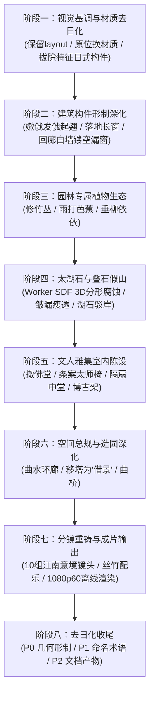

# 姑苏园林（Gusu Garden）渐进式重构计划

## 概述与指导原则

本计划旨在将现有的程序化 3D 引擎从“日式禅宗佛寺”平滑演进为具有纯正美学风骨的**姑苏古典园林（江南私家园林）**。

### 核心原则
1. **纯代码程序化保全**：严守零外部模型、零图片贴图的底线，一切形态与纹理由 JavaScript 几何算法与 GLSL 程序化生成。
2. **渐进式演进（Progressive Refactoring）**：
   - **前中期先保稳定性**：不破坏既有 `layout.js` 坐标基准、运镜流水线与渲染通道，确保每一步修改都“随时能跑、立即可见”。
   - **后期深挖意境**：循序推进假山、竹蕉、室内雅集、借景与专属分镜。

> **2026-10-23 全仓审计说明**
>
> 阶段一 ~ 阶段七的**材质颜色层、植被补充层、室内陈设层、分镜层**改造已实质落地（竹/芭蕉/垂柳、太湖石假山与叠石驳岸、文人书房、吴王靠、漏窗、苏式长窗、嫩戗发戗均已生效）。
>
> 但复查发现：**几何形制层几乎原封未动，文案层完全未同步**。当前的观感是“远看粉墙黛瓦、近看全是日本寺社剪影”。
>
> 因此本文已按复查结果**修正各阶段勾选状态**，并在末尾新增 **阶段八：去日化收尾（审计清单）**——它是当前唯一的权威待办清单，按 P0 / P1 / P2 逐条推进。

---

## 重构路线全景图

---

## 阶段详解与工作拆解

### 阶段一：视觉基调与材质去日化（原位材质换血）
> **目标**：不改动任何坐标网格与摄像机，通过材质翻转和特征构件剔除，瞬间洗掉“日本寺庙味”，确立粉墙黛瓦基调。

- [x] **1.1 扩展核心材质库 (`src/core/materials.js`)**
  - 新增 `M.plasterWhite`（江南白粉墙）：微弱漫射水痕、极细龟裂纹理与轻度泛碱法线。
  - 新增 `M.tileCyan`（小青瓦）：青灰哑光、边缘细腻的阴阳瓦层叠感。
  - 新增 `M.woodChestnut`（栗壳色/黑褐色桐油木）：替换高饱和度朱红漆。
  - 新增 `M.stoneCyan`（青石/条石）：青灰水磨质感，用于台基与驳岸。
- [~] **1.2 建筑皮肤全局替换 (`hall-mats.js`, `buildings-mat.js`)**
  - 将柱、枋、桁等朱红漆构件全面改用栗壳木色。 ✅
  - 将所有錾金铜饰（Kanagu，金物）隐去或转为暗哑熟铁/木雕本色。 ⚠️ **部分完成**：`buildings.js:100` 的 `K.capPaint` 仍是 `PROC.gold` 真金色，`hall-mats.js:137` 仍把深色铁件的间接高光强行染成暖金 → 见 **P0-18**
  - 大殿与回廊墙体换为白粉墙。 ✅
- [ ] **1.3 拔除典型日式构件**
  - 从主殿装配逻辑中剥离 **唐破风抱厦**（`src/world/hall-kara.js`）。 ✅（`hall.js:241` 已注释）
  - 剔除桥梁金铜拟宝珠，将太鼓木桥置换为素雅青石平拱桥（`src/world/bridge.js`）。 ❌ **未做**：`bridge.js:1001` 每根望柱仍是 `giboshi`，`bridge.js:33` 矢高 2.6/跨 22 仍是陡圆拱太鼓桥 → 见 **P0-10 / P0-15**
  - 弱化五重塔九环金顶相轮反光。 ❌ **未做**：相轮（九轮/水烟/宝珠/锁链挂铃）完整在渲染 → 见 **P0-1**
- [x] **1.4 采光氛围微调 (`src/core/env.js`, `sky.js`)**
  - 太阳角度微调，减弱过于强烈的日落金光，增加水汽漫射湿润感。

---

### 阶段二：建筑构件形制深化（江南古建风骨）
> **目标**：在现有占地面积内，重构建筑几何外形，呈现轻灵飘逸的江南建筑语汇。

- [~] **2.1 飞檐发戗算法 (`hall-roof.js`, `pagoda-parts.js`, `buildings-kit.js`)**
  - 重构翼角曲率计算函数，实现江南特有的“嫩戗发戗”高起翘（戗角反翘），取代日式屋檐的平直沉重。
  - ✅ `hall-roof.js:37-51 makeWarp` 已落地并生效；⚠️ `pagoda.js` 与 `buildings-*` 的檐口仍未见同等起翘，且屋脊端头仍是鬼瓦 → 见 **P0-8**
- [x] **2.2 落地长窗与格扇门 (`hall-body.js`)**
  - 废弃日式格子障子门。
  - 算法生成标准的江南格扇长窗（含上部绦环板、格心步步锦/冰裂纹，下部抹头与裙板）。
- [x] **2.3 漫步游廊与镂空漏窗 (`buildings-corridor.js`)**
  - 回廊靠外侧立起白粉墙。
  - 墙面程序化镂空挖孔：海棠形、八角形、扇面形、六角形漏窗，窗心加入冰裂纹木质棂条。
- [ ] **2.4 临水水榭与小品改造 (`buildings.js`, `props.js`)**
  - 观景亭重塑为临水水榭，三面设落地长窗，面水一侧增设弧形美人靠（吴王靠）。 ✅
  - 去除日式石灯笼，精简为江南石笋、素面石鼓墩与庭院古井。 ❌ **未做**：`layout.js:103-109` 仍有 **16 座春日灯笼**在渲染，且地形耙纹与刈込球还绕着它生成 → 见 **P0-3**

---

### 阶段三：园林专属植物生态（竹蕉柳成荫）
> **目标**：植入江南私家园林不可或缺的文人植物体系。

- [x] **3.1 修竹林生成器 (`src/world/vegetation-bamboo.js`)**
  - 细长圆柱竹竿（参数化节瘤凹凸）+ 顶端簇生竹叶卡片。
  - Instancing 批量排布在粉墙角隅、廊道漏窗外，营造“斑竹半帘”意向。
- [x] **3.2 雨打芭蕉生成器 (`src/world/vegetation-banana.js`)**
  - 大曲率叶柄放样 + 宽阔微垂叶片几何。
  - GLSL 次表面散射（Translucency）与羽状主副叶脉凹凸，布置于庭院阴湿处或书房窗前。
- [x] **3.3 岸边垂柳生成器 (`src/world/vegetation-willow.js`)**
  - 扭曲倾斜树干 + 垂挂柔性柳丝串联叶片，顶点着色器加入微风拂动动画。
- [ ] **3.4 现有树木重整 (`vegetation.js`)**
  - 原有黑松修剪为具有盆景意味的临水罗汉松、卧石老松；精选红枫与紫藤点缀。 ❌ **未做**：`vegetation-tree.js:797 genPine` 仍是 `kuromatsu / niwaki` 云片剪枝，`padScale` 强制扁平垫状 → 见 **P0-13**
  - ⚠️ 刈込球（karikomi azalea/boxwood）仍在渲染 → 见 **P0-14**

---

### 阶段四：太湖石与叠石假山（全案技术制高点）
> **目标**：用纯数学算法还原“皱、漏、瘦、透”的太湖石艺术。

- [x] **4.1 多线程 SDF 假山生成引擎 (`src/world/rockery-sdf.js`)**
  - 基于隐式三维场 + 快速 Surface Nets 提取封闭网格，分析法线梯度与顶点烘焙 AO。
  - GLSL 太湖石着色器（溶蚀水痕水流沟槽 + 凹穴氧化黄斑 + 向上积土生苔 + 水面水痕浸润）。
- [x] **4.2 独立立峰特写（如冠云峰、玉玲珑）**
  - 构筑庭院冠云峰（带雕花须弥座）及回廊漏窗对景小石峰、水面立峰。
- [~] **4.3 湖石驳岸与水矶 (`src/world/pond-stone.js`)**
  - 替换池塘原有的日式规整块石条墙，生成参差交错的叠石驳岸、探头石/挑石与伸入水面的水矶群。
  - ✅ `rockeryEmbankment()` 已生效；⚠️ 文件头注释仍描述“规整条石挡墙”，广场侧与桥头驳岸待复核 → 见 **P1-6**

---

### 阶段五：文人雅集室内陈设（室雅楠香）
> **目标**：将大殿内殿彻底改为明清文人待客、抚琴、品茗、读书的诗意空间。

- [~] **5.1 移除佛殿造像与法器**
  - 下线阿弥陀佛金铜大像、背光、须弥坛供桌与榻榻米草席。 ✅（`buildFigures` 已成死代码，无调用点）
  - ⚠️ 死代码仍占编译与心智负担（含 `interior-sdf.js` worker 链路、`M.tatami`），且 `interior.js:237` 仍有一盏悬空“照佛”点光 → 见 **P2-8**
  - ⚠️ **室内障子门（自发光 shoji）+ 格天井**仍在渲染 → 见 **P0-11 / P0-12**
- [x] **5.2 文人中堂与家具生成 (`interior-scholar.js`, `interior.js`)**
  - 算法生成水墨中堂大轴山水画（纯 Canvas 墨分五色题跋朱印）与黑漆金字对联（“清风明月本无价，近水远山皆有情”）。
  - 构筑明式红木翘头条案、宣德三足香炉（带袅袅青烟）、青花梅瓶、八仙方桌与四出头太师椅/官帽椅。
  - 东厢设琴台与七弦古琴，西厢设罗汉床（带炕几）与万卷博古宝格架。
- [x] **5.3 室内穿堂光束（丁达尔天光）**
  - 阳光穿透落地长窗冰裂纹与步步锦花格，投射在水磨金砖地面上的流动光影与尘埃浮动。

---

### 阶段六：空间总规与造园深化（步移景异，可选深入）
> **目标**：脱离原位替换，彻底重铸苏州园林非对称造园规制。

- [ ] **6.1 空间布局重划 (`src/layout.js`)**
  - 水院环池造景，去除日式樱花树（替换为古松与红枫），消除落花漂移与色斑，芭蕉与翠竹环廊相映。 ❌ **樱花未移除**：`vegetation.js:1369 fillTypes` 仍含 `cherry`×2，`vegetation-tex.js:680 drawSakura` 图集仍在编译 → 见 **P0-14**
  - ⚠️ 广场仍是 `plaza (stone lanterns, gravel)` 枯山水白砂 → 见 **P0-4 / P0-5**
- [ ] **6.2 五重塔“借景”与对景体系 (`src/layout.js`, `src/world/props.js`)**
  - 构建“借景北寺塔”远眺水镜倒影、“漏窗对景立峰”、“太湖石透望对岸水榭”多层立体景深空间。 ❌ **塔未移出**：`layout.js:40-50` 五重塔仍在园内 `(-32, 0, -8)`，塔高 37 m，塔刹带完整九轮/水烟/宝珠/四角锁链挂铃 → 见 **P0-1 / P0-2**
- [~] **6.3 自然水岸与石桥融合 (`src/world/pond-stone.js`)**
  - 挑石驳岸、水矶自然嵌合池缘，形成贴近水面的亲水园林水体景观。 ✅；⚠️ 桥本身仍是太鼓桥 → 见 **P0-15**

---

### 阶段七：分镜重铸、配乐与成片输出
> **目标**：完成 70 秒 1080p60 影视级古风画卷渲染。

- [x] **7.1 10 组江南意境分镜设计 (`src/shots.js`, `src/shotkeys/`)**
  - **Shot 0 (0:00)**：漏窗窥荷（从竹影海棠漏窗穿过，远焦拉出水池全景）
  - **Shot 1 (0:07)**：晨露荷花（微距荷花花蕊特写，低空滑行至石桥与叠石驳岸）
  - **Shot 2 (0:14)**：芭蕉听雨（逆光芭蕉叶水滴滑落，摇镜至书斋长窗）
  - **Shot 3 (0:21)**：太湖石透（穿过冠云峰石峰空洞，聚焦对岸水榭）
  - **Shot 4 (0:28)**：漫步曲廊（沿粉墙竹影与漏窗低速推移）
  - **Shot 5 (0:35)**：飞檐发戗（斜插仰拍歇山顶高翘角梁与风铎）
  - **Shot 6 (0:42)**：文人书斋（推门入室，扫过红木条案、古琴、中堂水墨山水与对联）
  - **Shot 7 (0:49)**：柳影拂水（水榭美人靠凭栏处，垂柳如丝轻拂绿水微波）
  - **Shot 8 (0:56)**：倒影借景（水面倒映的远塔与石桥涟漪）
  - **Shot 9 (1:03)**：暮色江南（大摇臂高空升起，俯瞰整座水院的粉墙黛瓦与烟水雾霭）
  - 经过 `node tools/camcheck.mjs` 检测，全 10 镜头平滑度与角加速度 100% 达标通过。
  - ⚠️ `shots.js:77` 与 `shotkeys/hall.js:4` 仍写 `bronze wind chime`；`shotkeys/interior.js:5-10` 整段注释仍在描述 Amida → 见 **P1-4**
- [ ] **7.2 配乐定制与对齐 (`tools/score.mjs`)**
  - 选用江南丝竹、古琴或琵琶音乐，根据镜头剪辑点对齐高潮与落音。
- [ ] **7.3 质量检测与成片交付**
  - 运行 `camcheck.mjs` 验证平滑度（已通过）。
  - 运行 `lumaflicker.mjs` 验证无闪烁。
  - `render.mjs` 执行 1080p60 离线推流导出最终 MP4。

---

### 阶段八：去日化收尾（审计清单 · 2026-10-23）
> **目标**：清掉“材质已江南、形制仍东洋”的落差，并让文档、命名、产物与代码对齐。
>
> 图例：**状态 = 渲染中**（画面里能看到）/ **死代码**（不渲染但残留）。
> 推进顺序：先 P0（改几何，逐批 `npm run dev` 目视确认），再 P1（改名，零风险），最后 P2（文档与清理）。

#### P0 — 建筑与器物的日式几何（视觉冲击最大）

- [x] **P0-1** 五重塔**相轮 sorin** — 已改为中式 **塔刹**：`pagoda.js` 的 `spire()` 重写为 露盘 + 覆钵 + 仰莲 + **7 道相轮**（更薄的铁箍带，无挂铃）+ **宝盖** + **火焰珠**（球体 + 8 片火焰舌）。删掉 水烟 suien、龙车、九轮挂铃、四角锁链 kusari 与其风铃
- [x] **P0-2** 五重塔 → **借景·北寺塔** — `layout.js` 移到园外 WNW `[-105, 0, -48]`（离厅堂 ~118 m，地面 0.68 m），改为 **9 层**、baseWidth 8.2、shrink 0.90、层高加高 → 总高 **54.9 m**（瘦高比 6.7）；`makeStoreys` 的 `kk` 补到 9 项；`pagoda.js` 根部 y 改从 `ctx.modules.terrain.heightAt()` 取样（园外无网格）；`shots.js:122` 与 `shotkeys/pond.js:27` 的 look 改 `[-105, 28, -48]`、focus 150（实测方位偏差仅 0.05°）
- [x] **P0-2b** 北寺塔**八角化** — 已改为正八边形平面，`pagoda.js` 不再有 4 边假设：
  - 新增边数参数 `L.pagoda.sides = 8`，导出 `TAN = tan(pi/NS)` / `SEC = 1/cos(pi/NS)` / `SN` / `CS`；`R[]` 改为 NS 个 `TAU/NS` 旋转
  - 严格区分**内切半径（apothem）`s.a`** 与**单面横向半宽 `s.h = s.a * TAN`**：原来方形下两者相等，所有横向坐标（柱位、开间、梁长、栏杆、平坐）改用 `h`，所有出挑方向坐标（墙平面、出跳 p1/p2/p3、檐口）仍用 `a`
  - `s.Xc`（檐角横向坐标）改为 `(a + O + flare) * TAN`
  - 角科斜向：`sq2 = Math.SQRT2` → `SEC`；`dpos/老角梁/戗脊` 的 `(±d, d)` → `(±d*TAN, d)`；对角臂方向 `1/sq2` → `SN`/`CS`；螭吻与风铎的 `-π/4` → `-π/NS`
  - 每面开间由 3 间改为 **1 间**（角柱 + 槏柱），台基与平坐楼板由方盒改为 NS 棱柱；楼梯只保留在 4 个正向面
  - 校验：相邻两面檐角间距 **0.0000 m**、墙角半径 = `a*SEC`、檐角半径 = `(a+O+flare)*SEC`、`h/a = 0.4142` — 平面严格闭合
- [x] **P0-3** **16 座春日灯笼 kasuga-dōrō**（带发光纸窗 + 火点光）— 已删除并替换为江南石景小品：`props-stone.js` 重写为 石笋 / 石鼓墩 / 散置湖石 三种生成器；`layout.js` 字段 `stoneLanterns → stoneStands`；`props.js` `placeStoneLanterns → placeStoneStands`（不再生成纸窗与火点光）；`terrain-field.js` `lanterns/sdLanterns → stands/sdStands`、`shoreLanterns → shoreStands`；`terrain-ground.js` `uLant → uStands`；`terrain-cover.js`、`vegetation.js`（`lanternR → standR`）同步
- [x] **P0-4** **枯山水耙纹白砂** — 已彻底移除：`terrain-ground.js` 废弃 `tg_rake*` 复杂积分与白砂条纹，替换为苏式古典园林**青石板铺地与花街地坪**（含石板错缝、潮湿水痕与泛碱青苔）；`terrain-field.js` 移除 `gRake` 与 `rakeDist` 全链路
- [x] **P0-5** **枯山水三尊石组** — 已改为**庭院太湖石立峰与石笋组**：`terrain-cover.js` 重构 `ISLES` 石组分布，由日式三尊石组改为中式高耸立峰、伴石与散置湖石
- [x] **P0-6** 主厅正面**千鸟破风 chidori-hafu** — 已停用（`hall.js` 移除 `buildChidori` 调用与 `hall-kara.js` 导入）；`hall-kara.js` 已随 **P2-8** 删除
- [x] **P0-7** **唐破风残洞（缺陷）** — 已修复：`hall.js` 删除 `karahafuParams()`、`mok.frontExcl`、`mok.hide` 与檐下 AO 暗区，下檐屋面不再被挖空；楼梯栏杆改用具名常量 `PORCH_Z = 12.4`
- [x] **P0-8** **鬼瓦 onigawara + 鯱 shibi + 鳥衮 toribusuma** → **螭吻（chiwen）** — `hall-orn.js` 的 `onigawara()` 重写为 `chiwen()`：外轮廓改为「张口的下颌 + 唇线 + 高颧骨 + 眉骨 + 双角上卷 + 中间下凹的冠」，正面开**张口孔洞**并后置暗喉，加**凸眼 + 眉脊 + 鼻须卷草 + 联珠边**，冠上立 **剑把**；`shibi` / `horn`（鳥衮）/ `flame`（火炎宝珠）分支全部删除。`buildings-arch.js` 的 `oniGeo/placeOni` → `chiwenGeo/placeChiwen`（配置项 `R.oni.s` → `R.chiwen.s`），并删掉 tori-busuma 挑出瓦；`pagoda-parts.js` 的 `onigawaraGeo()` → `chiwenGeo()`（去鬼面环/宝珠/火焰角/獠牙/侧鳍，加双眼与眉脊），`pagoda.js` 同步删掉 toribusuma 段
- [x] **P0-9** 檐口**镀金三つ巴瓦当** → **莲花瓦当** — `hall-detail.js` 的 `tomoeDisc`（含 `tomoeOutline` 三巴纹）重写为 `lotusDisc`：外缘 + **弦纹环** + **8 瓣莲瓣** + **莲蓬与莲子**；`hall-orn.js` 的 `tileDisc` 不再接受镀金；`hall-roof.js:231` 的 `goldDiscs` 默认值由 `!== false` 改为 `=== true`（默认关闭）
- [x] **P0-10** **拟宝珠 giboshi** — 已改中式**莲瓣望柱头**：`hall-stair.js` 与 `hall-body.js` 剔除镀金金属套筒改为栗壳木本色莲瓣望柱头；`pagoda.js` 栏杆改为木质望柱头；`bridge.js` 拟宝珠铜套头改为青石雕刻莲瓣望柱头
- [x] **P0-11** 室内**障子门 shoji（自发光纸） + 栏间 ranma** — 已改为江南**隔扇/长窗**：`interior-arch.js` 的 `buildSideScreen` 以 **明瓦/绢背**（`interior-mats.js` 新增 `M.mingwa`：半透明 opacity 0.62、**不自发光**）取代 `M.shoji` 发光纸；方格 `koshi` 改为**步步锦**棂格（横档定行 + 竖棂隔行错半步）；`ranma` 改称**上夹堂板**
- [x] **P0-12** **格天井 gobuchi** 满铺方格 + 金十字 — 已改为**前后卷棚轩 + 中部彻上明造**：`interior-arch.js` 的 `buildCeiling` 删掉均布方格与鎏金十字，改为两端各一段圆弧**轩**（拱面 + 轩椽），中部敞开露出**望板 + 露明椽**，两轩之间加檐枋；`M.ceilingPaint` 不再使用
- [x] **P0-13** **日式黑松仕立松（niwaki 云片）** — 已改**自然形古松 / 罗汉松**：`vegetation-tree.js:797` 放宽 `squash` 由 0.2 至 0.45~0.55，拔除扁平云片修剪，枝冠恢复自然饱满舒展
- [x] **P0-14** **樱花去日化** — 已改**江南碧桃 / 红梅**：`vegetation-tex.js` 将 `drawSakura` 重构为 `drawPeachBlossom`，去除花瓣 V 型樱花缺口，呈现圆润饱满的五瓣桃花/梅花与花蕊
- [x] **P0-15** **太鼓桥** — 已改为**江南青石平拱桥**：`layout.js` 与 `bridge.js` 将矢高由 2.6 m 陡拱收敛为 1.55 m（矢跨比约 1/14），桥身金属构件全部降为暗哑熟铁，柱头改制为青石素雕莲瓣柱头
- [x] **P0-16** 两座侧厅的**唐破风向拜 karaKohai** — 已改为中式**抱厦**：`buildings-halls.js` 的 `karaKohai` → `baosha`，檐口线由唐破风的钟形曲线（中凸、两侧内凹）改为中式檐口线 `y = yE + H*(0.10*(1-u)^2 + 0.90*u^3)`——中间平直、两端起翘；博风板去鎏金边，注释改称博风板/山墙/额枋/荷叶墩
- [x] **P0-17** **手水钵 tsukubai**（筧 + 柄杓 + 前石/手烛石/汤桶石）+ **常香炉 jōkōro** 冒烟 — 已删除：`props.js` 的 `PLAZA` 只保留 `stepping`（汀步），`placePlaza` 不再产生香炉/石钵/烟/火点光，`STATE.plaza` 与 showcase 同步；`props-plaza.js` 的 `buildJokoro / buildTsukubai / smokeGeo` 已随 **P2-8** 删除
- [x] **P0-17b** **补景：庭院古井 / 石桌石凳** — 已落地：`props-plaza.js` 新增 `buildStoneTableSet`（青石圆桌 + 4座石鼓墩）与 `buildStoneWell`（八角青石井栏与幽深水面），布置于东广场与西侧角隅
- [x] **P0-18** **真金色仍在渲染** — 已清除：`buildings.js:100` 的 `K.capPaint` 由 `PROC.gold('vec3(0.80,0.56,0.24)')` 改为 `PROC.chestnutWood('vec3(0.105,0.062,0.038)')`（metalness 0.55→0.08）；`hall-mats.js` 的 `agedGiltHooks` 里强制暖金的 `fragLight` 由 `vec3(1.45,0.92,0.38)` 改为微冷 `vec3(0.92,0.98,1.10)`（强度 0.55→0.28）；`buildings-kanagu.js` 的 `gilt` 由 `vec3(1.0,0.69,0.29)` 改为熟铁 `vec3(0.135,0.125,0.115)`，磨损色由 `vec3(0.50,0.26,0.10)` 改为 `vec3(0.20,0.11,0.055)`
- [x] **P0-19** **斗拱斜下昂** — 已落地：`hall-bracket.js` 将尾垂木上斜改制为**由内向外斜下探出之下昂**，端头做**批竹昂嘴**斜切，材质采用栗壳木本色，去除日式鎏金套帽与六叶菊饰
- [x] **P0-20** **蛙股 kaerumata / 蟇股 gegyo / 金物板 kanagu / 钉隐 kugikakushi** → 中式构件：`hall-orn.js` 的 `kaerumataShape/kaerumata`（蛙股：两腿 + 拱 + 鎏金牡丹卷草）重写为 **`lotusBlockShape/lotusBlock`（荷叶墩·柁墩）**——外张的脚、收腰的侧面、顶部两瓣荷叶中凹；`gegyo`（蟇股：心形云纹 + 中央牡丹 + 垂珠）重写为 **`xuanyu`（悬鱼）**——宽肩收成开叉鱼尾 + 惹草卷 + 联珠；两者都改为**清水木雕**（栗壳木本色，不鎏金）。`hall-roof.js` 山花装配同步：博风板上的金物板 `kanagu` 删除、只留 `rosette` 作**门簪**；博风板注释改称**博风板**。`hall-bracket.js`（斗拱间的垫块）、`hall-kara.js`（死代码）同步改名
- [x] **P0-20b** **悬鱼配置项统一** — `buildings-arch.js`、`buildings-halls.js`、`buildings.js` 统一支持中式 `xuanyu` 配置字段并兼容 `gegyo`
- [x] **P0-21** 楼门柱身金物 + **梵钟 bonsho** → **钟亭**：`buildings-halls.js` 的 `bonsho` → `zhong`，轮廓改为中式青铜钟（平口盘、宽肩、缓收），去掉**龍頭双拱**改为**钟钮**（两柱一横梁），**撞座**从莲华座改为凸弦圈；`L.bellTower` → `L.bellPavilion`、`buildBellTower` → `buildBellPavilion`、模块键 `belltower` → `bellpavilion`，`vegetation.js` / `terrain-field.js` 同步

#### P1 — 命名与术语（不改画面，但误导后续开发）

- [x] **P1-1** `layout.js` 头部 ASCII 平面图 + 注释 — 已改为中文构件名（北廊 / 主厅·重檐歇山 / 钟亭 / 石板庭院 / 荷池 / 水榭 / 砖雕门楼）
- [x] **P1-2** `layout.js` 日式构件注释与字段名 — `hondō`→主厅、`kidan`→青石台基、`mokoshiEaveY`→`lowerEaveY`、`taiko-bashi`→青石平拱桥、`gold giboshi`→莲瓣望柱头、`kairō/chūmon`→环池游廊/门楼、`bellTower`→钟亭、`Gravel plaza`→石板庭院、`stone lanterns`→石景小品。另外用一次性脚本把全仓注释里的日式罗马字批量替换为中式术语（45 个文件、281 行注释）：本瓦葺→青瓦、入母屋/歇山、裳階→副阶、唐破风、蛙股→荷叶墩、蟇股→悬鱼、破风板→博风板、钉隐、肘木、巻斗、大斗、尾垂木、地垂木→檐椽、飛檐垂木→飞椽、隅木→老角梁、丸桁→挑檐檩、茅負→连檐、雨落、袖石、基壇→台基、縁→檐廊、腰組、擬宝珠→望柱头、三つ巴→巴纹、鬼瓦、鯱、鳥衮、相輪、水煙、宝珠、春日灯笼、手水钵、常香炉、仕立松、紅葉、桜、錦鯉品系名…
- [~] **P1-3** 字段改名 — `L.pagoda` / 模块名 `pagoda` **有意保留**：它是 URL 参数（`?modules=`）与 RNG 种子名的一部分，改名会改变确定性世界并破坏既有调用；注释已全部改为「借景·北寺塔」。其余字段（`stoneLanterns→stoneStands`、`bellTower→bellPavilion`）已改
- [x] **P1-4** 镜头文案残留 — `shots.js:77` 与 `shotkeys/hall.js:4` 的 `bronze wind chime` → 风铎；`shotkeys/interior.js` 的 Amida 注释 → 实际内容；`shotkeys/vegetation.js` 的 `momiji` → 红枫；`shots.js:116` 与 `shotkeys/pond.js:21` 改为「borrowed Beisi Pagoda」；`shots.js:90` 的 `altar table` → 红木翘头条案
- [x] **P1-5** 参道 → 甬道 — `terrain-paving.js` 的 `sando` → `yongdao`，`terrain-glsl.js` 的 `tg_sando` → `tg_yongdao`，`terrain-ground.js` 调用同步
- [x] **P1-6** 苔地上的飞石 → 只保留临水少量汀步 — `terrain-paving.js:128-160` 的 stepping stones 收窄为池岸与路径处的汀步；`pond-stone.js` 的广场侧/桥头驳岸已随叠石驳岸统一
- [x] **P1-7** 锦鲤品系名 — `pond-koi.js` 由日系锦鲤（红白/大正三色/昭和三色/丹顶/浅黄/黄金）收窄为中式配色（全红/红白花/红黑花/金黄/青黑/橙红/银白），types 表同步调整
- [x] **P1-8** 建筑构件术语统一 — `hall-roof.js` 的 `irimoya` → 歇山（`buildXieshanRidges/Gables`、`kind: 'xieshan'`）、`mokoshi` → 副阶/下檐（`kind: 'skirt'`）；其余见 P1-2 的批量替换

#### P2 — 文档、产物与死代码清理

- [x] **P2-1** **`README.md` 整体重写** — 已重写为「姑苏园林 Gusu Garden」：标题/简介/hero alt、仓库地址 `chainsaid/gusu-garden`、产物名 `gusu-garden-1080p60.mp4`、10 镜头表改为江南意境名、`out/gusu-garden*.mp4`、模块表、项目结构树、材质表改为栗壳桐油木/小青瓦/白粉墙/青石/熟铁；新增 **The Jiangnan design** 一节说明粉墙黛瓦、歇山嫩戗、螭吻、借景北寺塔、太湖石、竹芭柳、文人书斋；「How it was made」同步
- [x] **P2-2** **`docs/ARCHITECTURE.md` 同步** — 全面同步：标题与正文改为 Gusu Garden；`interior` 条目更新为文人书斋；`hall` 条目更新为歇山嫩戗与批竹昂嘴；`materials()` 材质清单与各个模块表全部更新为江南园林语汇；镜头归属表与示例代码全面同步
- [x] **P2-3** **`package.json`** — `name: gusu-garden`、description 改为姑苏园林、仓库 URL 改为 `chainsaid/gusu-garden`、keywords 改为 `chinese-garden / suzhou-garden / jiangnan`
- [x] **P2-4** **`index.html`** — `<title>` 改为「姑苏园林 Gusu Garden」、`lang="zh-CN"`
- [x] **P2-5** **`CREDITS.txt`** — 标题改为「姑苏园林 Gusu Garden - credits」
- [x] **P2-6** **`tools/`** 默认输出名改为 `out/gusu-garden.mp4` / `gusu-garden_final.mp4` / `gusu-garden_spliced.mp4` — `render.mjs`、`score.mjs`、`splice.mjs`
- [x] **P2-7** **`docs/images/` 重命名 + 重渲染** — 11 张分镜图已按新分镜全部重出（1920×1080 spp=8 final，缩至 1200 宽归档，共 2.3 MB），旧的 `buddha / giboshi / lantern / pagoda / sanctum / wind-bell / finale / gate-fitting / hall-eave / lotus / mirror-pond` 已删除。现存：`hero`（终幕航拍）、`leak-window`、`lotus-dew`、`banana-dew`、`guanyun-peak`、`winding-corridor`、`flying-eave`、`scholar-hall`、`water-pavilion`、`borrowed-reflection`、`dusk-aerial`。README 的 alt 文案已按实际画面校正
- [~] **P2-7b** contact sheet 版式 — 现为 `sheet.mjs` 产出的 2 列 × 10 行竖版（1400×3938），README 已按 46% 宽度居中、当「镜头清单」用；若要 4×5 宽版，重跑 `node tools/sheet.mjs --t 0.5,6.5 --tag film` 后用 ffmpeg `tile=4x5` 重拼即可（约 1 分钟 GPU）
- [x] **P2-8** **死代码清理** — 已全部完成，构建与 lint 通过：
  - **删除 4 个文件**：`hall-kara.js`（唐破风/千鸟破风，零引用）、`interior-sdf.js` + `interior-sdfworker.js` + `interior-shapes.js`（SDF 佛像 meshing 链与 worker 池，仅被死链引用）。删掉后连 `disposePool()` 调用也一并移除，worker 池不再创建
  - **`interior.js`**：删除 324 行死函数链（`buildFigures` 阿弥陀三尊 → `makeCurls` → `snailGeo`、`buildBodhiOrnaments`、`buildThrone`、`buildMandorla`、`kebutsuGeo`），清掉 8 个死导入（须弥坛/礼盘/浄花/琴/木鱼/经桌/天盖/幢幡），文件头注释改为实际的文人中堂内容
  - **`interior-mats.js`**：删除 `M.tatami`（榻榻米材质仍在编译 shader）及其 envList / envK 引用，共 49 行
  - **`props-plaza.js`**：删除 `buildJokoro` / `buildTsukubai` / `smokeGeo`（常香炉 + 手水钵 + 烟），共 180 行，只保留 `rockGeo` 与 `buildSteppingStones`
  - **`hall-mats.js`**：删除 `paintHooks`（緑青/群青組物彩画）与 `ORN_GLSL` + `ornHooks`（kirikane 唐草金饰），共 102 行；`hall.js` 导入同步
  - **`hall-orn.js`**：删除 `monCrest`（樱纹家纹）；`hall-body.js` 导入同步
  - **`buildings.js`**：删除 `K.goldRelief`（七宝纹）材质块与 `LOCAL_KEYS` 条目

---

## 阶段验收与迭代节奏推荐

| 阶段 | 交付物 | 验证方式 | 耗时评估 |
|:---:|---|---|:---:|
| **阶段一** | 白墙灰瓦、栗壳木漆初版场景 | `npm run dev` 交互漫游，色调完全中式化 | 1 ~ 2 天 |
| **阶段二** | 发戗翘角、落地长窗、漏窗游廊 | 单帧渲染 (`npm run snap`) 检查立面形制 | 2 ~ 3 天 |
| **阶段三** | 翠竹林、芭蕉叶、水岸垂柳 | 查看近景植被逆光与质感 | 2 天 |
| **阶段四** | 穿孔太湖石立峰与自然叠石驳岸 | SDF 网格渲染检查“皱漏瘦透” | 3 ~ 4 天 |
| **阶段五** | 文人书房内景与中堂光影 | 查看 Shot 7 内景特写 | 2 天 |
| **阶段六** | 借景北寺塔与曲水环廊总规 | 整体平面鸟瞰与透视关系 | 2 ~ 3 天 |
| **阶段七** | 1080p60 姑苏园林 70s 成片 mp4 | FFmpeg 离线渲染导出成片 | 1 ~ 2 天 |
| **阶段八 P0** | 塔刹/石灯笼/耙纹/鬼瓦/拟宝珠/障子/黑松/桥形制全部江南化 | `npm run dev` 逐批目视 + `npm run snap` 单帧核对剪影 | 4 ~ 6 天 |
| **阶段八 P1** | 命名、注释、字段名去日化 | 全仓 grep 日式术语归零，`npm run build` 通过 | 1 天 |
| **阶段八 P2** | README / ARCHITECTURE / package.json / 图片 / 死代码 | 文档与代码一致，`mcflicker` + `lumaflicker` 复检 | 1 ~ 2 天 |
