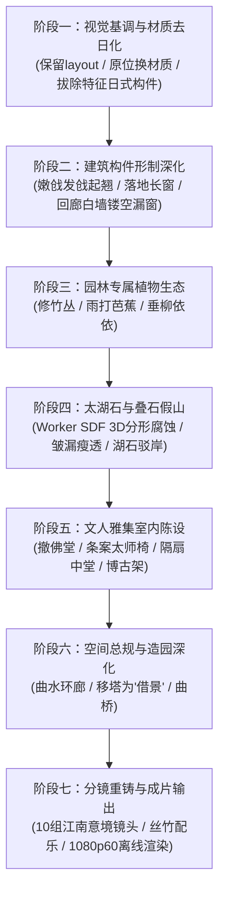

# 姑苏园林（Gusu Garden）渐进式重构计划

## 概述与指导原则

本计划旨在将现有的程序化 3D 引擎从“日式禅宗佛寺”平滑演进为具有纯正美学风骨的**姑苏古典园林（江南私家园林）**。

### 核心原则
1. **纯代码程序化保全**：严守零外部模型、零图片贴图的底线，一切形态与纹理由 JavaScript 几何算法与 GLSL 程序化生成。
2. **渐进式演进（Progressive Refactoring）**：
   - **前中期先保稳定性**：不破坏既有 `layout.js` 坐标基准、运镜流水线与渲染通道，确保每一步修改都“随时能跑、立即可见”。
   - **后期深挖意境**：循序推进假山、竹蕉、室内雅集、借景与专属分镜。

---

## 重构路线全景图

---

## 阶段详解与工作拆解

### 阶段一：视觉基调与材质去日化（原位材质换血）
> **目标**：不改动任何坐标网格与摄像机，通过材质翻转和特征构件剔除，瞬间洗掉“日本寺庙味”，确立粉墙黛瓦基调。

- [ ] **1.1 扩展核心材质库 (`src/core/materials.js`)**
  - 新增 `M.plasterWhite`（江南白粉墙）：微弱漫射水痕、极细龟裂纹理与轻度泛碱法线。
  - 新增 `M.tileCyan`（小青瓦）：青灰哑光、边缘细腻的阴阳瓦层叠感。
  - 新增 `M.woodChestnut`（栗壳色/黑褐色桐油木）：替换高饱和度朱红漆。
  - 新增 `M.stoneCyan`（青石/条石）：青灰水磨质感，用于台基与驳岸。
- [ ] **1.2 建筑皮肤全局替换 (`hall-mats.js`, `buildings-mat.js`)**
  - 将柱、枋、桁等朱红漆构件全面改用栗壳木色。
  - 将所有錾金铜饰（Kanagu，金物）隐去或转为暗哑熟铁/木雕本色。
  - 大殿与回廊墙体换为白粉墙。
- [ ] **1.3 拔除典型日式构件**
  - 从主殿装配逻辑中剥离 **唐破风抱厦**（`src/world/hall-kara.js`）。
  - 剔除桥梁金铜拟宝珠，将太鼓木桥置换为素雅青石平拱桥（`src/world/bridge.js`）。
  - 弱化五重塔九环金顶相轮反光。
- [ ] **1.4 采光氛围微调 (`src/core/env.js`, `sky.js`)**
  - 太阳角度微调，减弱过于强烈的日落金光，增加水汽漫射湿润感。

---

### 阶段二：建筑构件形制深化（江南古建风骨）
> **目标**：在现有占地面积内，重构建筑几何外形，呈现轻灵飘逸的江南建筑语汇。

- [ ] **2.1 飞檐发戗算法 (`hall-roof.js`, `pagoda-parts.js`, `buildings-kit.js`)**
  - 重构翼角曲率计算函数，实现江南特有的“嫩戗发戗”高起翘（戗角反翘），取代日式屋檐的平直沉重。
- [ ] **2.2 落地长窗与格扇门 (`hall-body.js`)**
  - 废弃日式格子障子门。
  - 算法生成标准的江南格扇长窗（含上部绦环板、格心步步锦/冰裂纹，下部抹头与裙板）。
- [ ] **2.3 漫步游廊与镂空漏窗 (`buildings-corridor.js`)**
  - 回廊靠外侧立起白粉墙。
  - 墙面程序化镂空挖孔：海棠形、八角形、扇面形、六角形漏窗，窗心加入冰裂纹木质棂条。
- [ ] **2.4 临水水榭与小品改造 (`buildings.js`, `props.js`)**
  - 观景亭重塑为临水水榭，三面设落地长窗，面水一侧增设弧形美人靠（吴王靠）。
  - 去除日式石灯笼，精简为江南石笋、素面石鼓墩与庭院古井。

---

### 阶段三：园林专属植物生态（竹蕉柳成荫）
> **目标**：植入江南私家园林不可或缺的文人植物体系。

- [ ] **3.1 修竹林生成器 (`src/world/vegetation-bamboo.js`)**
  - 细长圆柱竹竿（参数化节瘤凹凸）+ 顶端簇生竹叶卡片。
  - Instancing 批量排布在粉墙角隅、廊道漏窗外，营造“斑竹半帘”意向。
- [ ] **3.2 雨打芭蕉生成器 (`src/world/vegetation-banana.js`)**
  - 大曲率叶柄放样 + 宽阔微垂叶片几何。
  - GLSL 次表面散射（Translucency）与羽状主副叶脉凹凸，布置于庭院阴湿处或书房窗前。
- [ ] **3.3 岸边垂柳生成器 (`src/world/vegetation-willow.js`)**
  - 扭曲倾斜树干 + 垂挂柔性柳丝串联叶片，顶点着色器加入微风拂动动画。
- [ ] **3.4 现有树木重整 (`vegetation.js`)**
  - 原有黑松修剪为具有盆景意味的临水罗汉松、卧石老松；精选红枫与紫藤点缀。

---

### 阶段四：太湖石与叠石假山（全案技术制高点）
> **目标**：用纯数学算法还原“皱、漏、瘦、透”的太湖石艺术。

- [ ] **4.1 多线程 SDF 假山生成引擎 (`src/world/rockery-sdf.js`)**
  - 复用 `interior-sdf.js` 的 Web Worker Marching Cubes 架构。
  - 使用 3D 细胞噪声（Voronoi）结合多尺度分形噪声（Perlin/Musgrave）进行布尔差集腐蚀，自然生成中空互通的天然孔洞。
- [ ] **4.2 独立立峰特写（如冠云峰、玉玲珑）**
  - 矗立于主殿前庭或水院对景焦点，供特写镜头穿透孔洞赏景。
- [ ] **4.3 湖石驳岸与水矶 (`src/world/pond-shore.js`)**
  - 替换池塘原有的规整块石驳岸，生成凹凸参差、随水势起伏的自然叠石岸线。

---

### 阶段五：文人雅集室内陈设（室雅楠香）
> **目标**：将大殿内殿彻底改为明清文人待客、抚琴、品茗、读书的诗意空间。

- [ ] **5.1 移除佛殿造像与法器**
  - 下线阿弥陀佛金铜大像、背光与大殿供桌。
- [ ] **5.2 文人中堂与家具生成 (`interior-*.js`)**
  - 构筑楠木条案、太师椅、方桌、花几、瓷器博古架。
  - 墙面悬挂水墨中堂山水画轴与木刻对联（纯 Canvas 算法渲染）。
- [ ] **5.3 室内穿堂光束（丁达尔天光）**
  - 保留并调优通过长窗格栅投射在地面水磨青砖上的斑驳夕阳/晨光光影。

---

### 阶段六：空间总规与造园深化（步移景异，可选深入）
> **目标**：脱离原位替换，彻底重铸苏州园林非对称造园规制。

- [ ] **6.1 空间布局重划 (`src/layout.js`)**
  - 打破南北贯通的轴线；以曲折池面为核心，建筑、游廊环水布置。
- [ ] **6.2 五重塔“借景”再造**
  - 将原在近景的五重塔平移至北侧远墙之外的高地上，复刻“拙政园借景北寺塔”千古绝唱。
- [ ] **6.3 园林名桥重构**
  - 将直跨拱桥改建为贴近水面的“小飞虹”廊桥或折角九曲青石平桥。

---

### 阶段七：分镜重铸、配乐与成片输出
> **目标**：完成 70 秒 1080p60 影视级古风画卷渲染。

- [ ] **7.1 10 组江南意境分镜设计 (`src/shots.js`)**
  - **Shot 1 (0:00)**：漏窗窥荷（从海棠漏窗穿过，远焦拉出水池全景）
  - **Shot 2 (0:07)**：晨露荷花（微距荷花花蕊特写，低空滑行至石桥）
  - **Shot 3 (0:14)**：芭蕉听雨（逆光芭蕉叶水滴滑落，摇镜至书房长窗）
  - **Shot 4 (0:21)**：太湖石透（穿过石峰空洞，聚焦对岸水榭）
  - **Shot 5 (0:28)**：漫步曲廊（沿粉墙竹影低速推移）
  - **Shot 6 (0:35)**：飞檐发戗（斜插仰拍歇山顶高翘角梁与风铎）
  - **Shot 7 (0:42)**：文人书斋（推窗入室，扫过条案对联与琴案香炉）
  - **Shot 8 (0:49)**：柳影拂水（垂柳枝条微摆，游鱼惊散）
  - **Shot 9 (0:56)**：倒影借景（水面倒映的远塔与廊桥涟漪）
  - **Shot 10 (1:03)**：暮色江南（大摇臂高空升起，俯瞰整座水院的粉墙黛瓦与烟水雾霭）
- [ ] **7.2 配乐定制与对齐 (`tools/score.mjs`)**
  - 选用江南丝竹、古琴或琵琶音乐，根据镜头剪辑点对齐高潮与落音。
- [ ] **7.3 质量检测与成片交付**
  - 运行 `camcheck.mjs` 验证平滑度。
  - 运行 `lumaflicker.mjs` 验证无闪烁。
  - `render.mjs` 执行 1080p60 离线推流导出最终 MP4。

---

## 阶段验收与迭代节奏推荐

| 阶段 | 交付物 | 验证方式 | 耗时评估 |
|:---:|---|---|:---:|
| **阶段一** | 白墙灰瓦、栗壳木漆初版场景 | `npm run dev` 交互漫游，色调完全中式化 | 1 ~ 2 天 |
| **阶段二** | 发戗翘角、落地长窗、漏窗游廊 | 单帧渲染 (`npm run snap`) 检查立面形制 | 2 ~ 3 天 |
| **阶段三** | 翠竹林、芭蕉叶、水岸垂柳 | 查看近景植被逆光与质感 | 2 天 |
| **阶段四** | 穿孔太湖石立峰与自然叠石驳岸 | SDF 网格渲染检查“皱漏瘦透” | 3 ~ 4 天 |
| **阶段五** | 文人书房内景与中堂光影 | 查看 Shot 7 内景特写 | 2 天 |
| **阶段六** | 借景北寺塔与曲水环廊总规 | 整体平面鸟瞰与透视关系 | 2 ~ 3 天 |
| **阶段七** | 1080p60 姑苏园林 70s 成片 mp4 | FFmpeg 离线渲染导出成片 | 1 ~ 2 天 |
