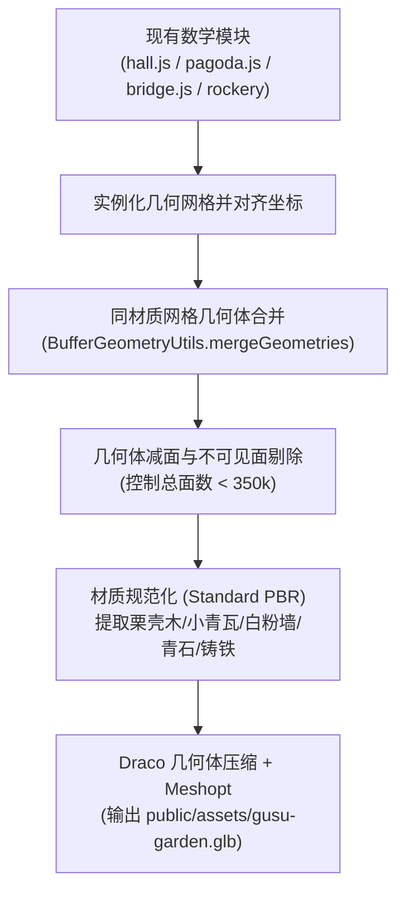
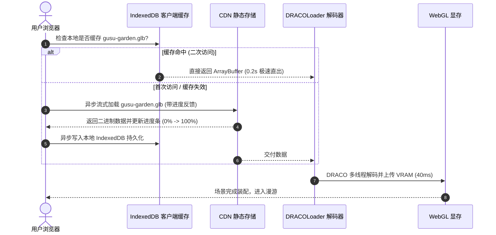
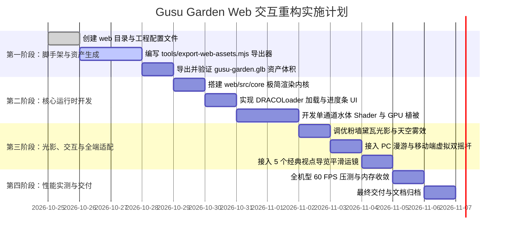

# 姑苏园林高性能 Web 交互版架构设计方案与实施规范
# Gusu Garden High-Performance Web Interactive Architecture & Design Specification

---

## 1. 项目定位与核心指标

本项目旨在基于现存的姑苏园林（Gusu Garden）数学模型与美学资产，构建一个**轻量、秒开、全端 60 FPS 流畅交互**的商业级 Web 3D 园林数字展厅。

### 1.1 核心矛盾与架构转向
- **原版定位**：1080p60 离线电影 CG 渲染器。全场景 2100 万面（21M Tris），依赖主线程 80 秒 CPU 纯算与 130 处动态 FBM 噪声 Shader 实时编译，无法满足网页实时交互。
- **新版定位**：**现代工业级 Web 3D 交互产品**。将原版作为“底层资产与算法参考源”，通过离线烘焙生成极致轻量的二进制 3D 模型资产，并在独立的 `web/` 运行时中实现秒开漫游。

### 1.2 目标性能基线（SLA）

| 关键性能指标 | 离线电影版现状 | Web 交互版目标基线 | 验收标准 / 监控手段 |
| :--- | :--- | :--- | :--- |
| **首屏加载耗时** | 40 ~ 80s+（CPU计算+Shader编译） | **≤ 1.5s（宽带/5G）/ ≤ 3s（4G网络）** | 首帧可交互时间（TTI），带精确百分比进度条 |
| **全机型帧率 (FPS)** | 10 ~ 25 FPS（集显与手机掉帧） | **稳定 60 FPS（PC/Mac/iOS/Android）** | `stats.js` 连续漫游不掉帧 |
| **模型资产体积** | 动态生成（内存占用 > 1.2GB） | **单文件 `.glb` ≤ 12 MB (Draco压缩)** | CDN Gzip/Brotli 传输 |
| **场景总多边形面数** | 21,000,000 面 | **≤ 350,000 面（35 万面以内）** | 几何体同材质合批减面 |
| **Draw Calls (批次)** | 800 ~ 1500+ | **≤ 45 次** | 全局材质统一与 InstancedMesh 合批 |
| **运行时显存 (VRAM)** | > 1.2 GB | **≤ 120 MB** | 贴图 WebP/KTX2 压缩 + 纯色 PBR 材质 |

---

## 2. 整体工程拓扑与目录结构

采用**方案一（顶级独立 `web/` 目录）**，实现资产生成器与交互运行时的彻底解耦。

```
gusu-garden/
├── docs/
│   ├── ARCHITECTURE.md                 # 原版系统架构
│   ├── REFACTORING_PLAN.md             # 原版重构历程
│   ├── JIANGNAN_LANDSCAPE_AUDIT.md     # 江南风格审计规范
│   └── WEB_INTERACTIVE_DESIGN.md       # [本文档] Web交互版设计规范
│
├── src/                                # 【原版参考源】纯代码算法与数学公式库（保持只读基准）
│   ├── core/                           # 原版着色器、材质与数学工具
│   └── world/                          # 原版古建、北寺塔、拱桥、假山生成函数
│
├── tools/                              # 【跨端转换桥梁】离线资产抽取与优化工具
│   ├── export-web-assets.mjs           # 一键从 src/world 抽取并导出为 Draco glb 的脚本
│   └── render.mjs                      # 原版电影渲染脚本（保留）
│
└── web/                                # 【全新 Web 交互工程】顶级独立应用目录
    ├── index.html                      # 纯净 HTML5 入口，自带内联加载动效
    ├── package.json                    # 独立的 Web 端脚本与轻量依赖配置
    ├── vite.config.js                  # 针对 Web 3D 优化的独立 Vite 配置
    ├── public/                         # 静态静态托管目录（CDN 直接映射）
    │   ├── favicon.ico
    │   └── assets/
    │       ├── gusu-garden.glb         # 导出的低多边形核心场景 (~10MB, Draco 压缩)
    │       ├── textures/               # 极简程序化法线与水波纹贴图 (WebP)
    │       └── audio/                  # 江南丝竹环境底噪与水声 (可选)
    └── src/                            # Web 端交互源码
        ├── core/                       # 极简渲染内核
        │   ├── engine.js               # WebGLRenderer 初始化、尺寸监听与自适应分辨率
        │   ├── loop.js                 # 统一 requestAnimationFrame 循环与帧率监测
        │   └── events.js               # 窗口与交互事件总线
        ├── scene/                      # 场景与资产管理
        │   ├── asset-loader.js         # DRACOLoader + 进度监听 + IndexedDB 缓存
        │   ├── environment.js          # 天空穹顶、雾效、太阳单光源与极简阴影
        │   ├── water.js                # 单通道高性能水面（深度渐变 + 法线流体）
        │   └── vegetation.js           # GPU InstancedMesh 翠竹、芭蕉与荷叶
        ├── controls/                   # 全端自适应控制器
        │   ├── camera-rig.js           # 自由视角与导览视角平滑插值系统
        │   ├── desktop-controls.js     # PC 端键盘 WASD + 鼠标视角锁控制
        │   └── mobile-controls.js      # 移动端触屏双虚拟摇杆支持
        ├── ui/                         # UI 覆盖层
        │   ├── loading-screen.js       # 0%~100% 极简水墨风格进度屏
        │   ├── tour-guide.js           # 5 个经典园林景点导览切换控件
        │   └── hotspot-overlay.js      # 建筑与景点可交互悬浮标签
        └── main.js                     # Web 交互应用主入口
```

---

## 3. 资产提取与烘焙规范（`tools/export-web-assets.mjs`）

资产导出工具利用 Node.js / Headless 环境运行现有 `src/world/*` 模块，将数学几何体转换为面向实时的标准 3D 资产。



### 3.1 资产包含子集与面数配额表

| 建筑/景观实体 | 来源模块 | 优化策略 | 面数配额 |
| :--- | :--- | :--- | :--- |
| **水榭主厅（主殿）** | `src/world/hall.js` | 歇山顶、嫩戗发戗、柱廊台基。瓦片由单片实体挤出降为凹凸贴图表达 | **80,000 面** |
| **借景·北寺塔（远景）** | `src/world/pagoda.js` | 沿用八角九级万斤铁刹形制；外部可见面保留，内部楼层与楼梯全部剔除 | **35,000 面** |
| **青石单孔平拱桥** | `src/world/bridge.js` | 保留拱券弧线与素面莲瓣望柱，剔除所有日式饰金具 | **15,000 面** |
| **太湖石驳岸与立峰** | `src/world/pond-stone.js` | 预烘焙网格形态（保留皱漏瘦透边缘），替代原版的实时 SDF 分形步进 | **60,000 面** |
| **荷池底面与驳岸基座** | `src/world/pond.js` | 荷池边缘硬化与青石条石对齐，池底简化为平缓碗底 | **10,000 面** |
| **庭院花街地坪与粉墙** | `src/world/buildings.js` | 提取白粉墙与漏窗几何，花街铺地作为大单片平面承载纹理 | **40,000 面** |
| **文人松柏骨架** | `src/world/vegetation-tree.js`| 提取苍古干枝轮廓，叶簇作为低多边形蓬松体 | **50,000 面** |
| **机动预留空间** | 案几、石桌、水井小品 | 简单几何体 | **30,000 面** |
| **总计** | | | **~320,000 面** |

### 3.2 材质统一与 Draw Call 压缩
导出脚本将所有独立网格按材质聚类合并为 **6 组主网格**：
1. `Mesh_WoodChestnut`（栗壳桐油木构件：柱、枋、桁、檐椽、长窗）；
2. `Mesh_TileCyan`（小青瓦屋面与屋脊）；
3. `Mesh_PlasterWhite`（白粉墙主体）；
4. `Mesh_StoneCyan`（青石台基、石桥、花街石条）；
5. `Mesh_TaihuRock`（太湖石立峰与驳岸石组）；
6. `Mesh_CastIron`（北寺塔铁刹、风铎）。
- **合并效果**：场景静态建筑部分的 Draw Calls 从原本的 1200+ 骤降至 **6 次**。

---

## 4. Web 交互运行时设计（`web/src/`）

### 4.1 核心渲染内核（`web/src/core/engine.js`）
- 启用抗锯齿：`antialias: true`，开启物理正确光照计算；
- 像素比自适应（DPR Control）：
  - PC 端默认 `Math.min(window.devicePixelRatio, 1.5)`；
  - 移动端限制为 `1.0`，平衡 Retina 屏幕发热与电量消耗；
- 动态分辨率降级策略（Dynamic Scaler）：
  - 监听连续 30 帧的平均帧率，若低于 45 FPS，自动平滑降低渲染视口分辨率至 0.85，确保漫游丝滑。

### 4.2 加载流水线与客户端持久化缓存（`web/src/scene/asset-loader.js`）



### 4.3 单通道高性能江南水面（`web/src/scene/water.js`）
彻底舍弃原版双重全景反射相机，重写单通道 Shader：
1. **法线扰动**：采样 1 张 256×256 的 WebP 水波法线贴图，通过双层不同速率的 UV 滚动合成自然微波；
2. **水体深浅透光**：读取深度缓冲（Depth Texture），计算水面片元到水底的距离：
   - 浅滩处为青碧浅绿并微露池底；
   - 深水处逐渐过渡为江南温润墨绿；
3. **环境反射**：基于水面法线做菲涅尔（Fresnel）反射采样天空穹顶；
4. **性能损耗**：水面仅仅是一个由 2 个三角形构成的单片 Plane，开销几乎等同于普通漫反射。

### 4.4 GPU 植被系统（`web/src/scene/vegetation.js`）
- **翠竹丛与荷叶**：
  - 采用 `THREE.InstancedMesh`，单次合批绘制 300 根翠竹与 200 片荷叶（总计仅 **2 个 Draw Calls**）；
- **GPU 顶点摇曳（Zero CPU Wind）**：
  - 在竹子和荷叶的顶点着色器（Vertex Shader）中注入微风形变算法：
    $$x' = x + \sin(t \cdot 1.8 + z \cdot 0.5) \cdot (y / H)^2 \cdot 0.08$$
  - 竹梢随着高度二次方自然摆动，叶片轻拂，CPU 占用率为 0%。

### 4.5 全端交互与导览系统（`web/src/controls/`）

#### A. 移步换景经典导览模式（Tour Mode）
预设 5 个经典的文人造园视点，支持一键平滑飞跃运镜（使用三次贝塞尔缓动）：
1. **【水榭晨曦】**：立于主厅月台，远眺荷池与烟水；
2. **【小飞虹外】**：侧视青石单孔拱桥与太湖石叠石倒影；
3. **【借景留香】**：经典拙政园视线——隔池借景雄浑古朴的北寺塔；
4. **【蕉石疏影】**：粉墙漏窗、芭蕉半展与太湖石立峰特写；
5. **【高台鸟瞰】**：45度俯瞰园林全景的粉墙黛瓦与曲径回廊。

#### B. 自由漫游模式（Free Walk Mode）
- **PC 端**：标准 WASD / 方向键位移 + 鼠标滑动视线，支持碰撞阻挡（避免穿墙）；
- **移动端**：屏幕左下角自适应弹出虚拟移动摇杆，右侧半屏支持手势滑动旋转视角，完全契合手机用户习惯。

---

## 5. 构建与工程部署流水线

### 5.1 依赖关系设计
`web/` 目录既可以作为一个子项目共享根目录的 `node_modules`，也可以保持自己的独立配置。我们通过根目录的 `package.json` 提供统一调用入口：

```json
{
  "name": "gusu-garden",
  "private": true,
  "scripts": {
    "dev:web": "vite serve web --port 3000 --open",
    "build:web": "vite build web --outDir ../dist/web",
    "export:assets": "node tools/export-web-assets.mjs",
    "dev:film": "vite --port 5173",
    "render:film": "node tools/render.mjs"
  }
}
```

### 5.2 资源部署与 CDN 结构
构建产物输出至 `dist/web/`：
- `index.html`（极小，主文档）；
- `assets/index-[hash].js`（Web 运行时代码，约 120KB，Gzip 后仅 40KB）；
- `assets/gusu-garden.glb`（独立大资产，放于 CDN 并配置长效缓存 `Cache-Control: max-age=31536000`）。

---

## 6. 分阶段实施路径与工期评估



---

## 7. 验收标准与测试矩阵（Test Matrix）

| 测试项 | 目标设备 / 环境 | 验收指标 | 判定规则 |
| :--- | :--- | :--- | :--- |
| **首屏加载** | Chrome 浏览器（限制 20Mbps 网速） | TTI ≤ 2.0s | 进度条平滑无跳变，加载完毕即进入交互 |
| **二次加载** | 本地 IndexedDB 缓存命中 | TTI ≤ 0.5s | 瞬间秒开 |
| **桌面端性能** | Intel Core i5 集成显卡 / M1 Mac | 1080p 稳定 60 FPS | 连续漫游 5 分钟无卡顿与内存泄漏 |
| **移动端性能** | iPhone 13+ / 骁龙 870+ 手机浏览器 | 稳定 55~60 FPS | 虚拟摇杆操作灵敏，手机不异常发烫 |
| **视觉品质** | 白粉墙、小青瓦、北寺塔借景 | 质感素雅真实 | 彻底消除和风痕迹，还原姑苏文人水墨意境 |

